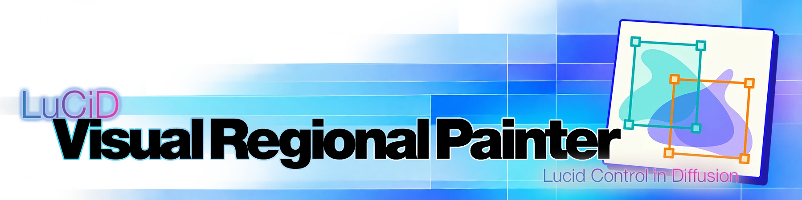
---
**LuCiD VRP** (Visual Regional Painter) brings image loading, layered editing, **Anima regional prompting**, and **MOSS-Image layout prompting** together in ComfyUI. Built with **image-to-image (img2img) workflows** in mind, it helps you compose, edit, and describe your next generation through a responsive visual interface.

Start with an image or a blank canvas in **LuCiD Canvas**, our lightweight built-in editor. Combine image layers, paint, transform, distort, and reversibly crop your artwork without leaving ComfyUI.

Guide your generation with **Anima regional prompting** or **MOSS-Image visual layout** tools. Draw, move, and resize boxes over your canvas, and give each region its own prompt. Keep regions inside one node or organize them into separate **VRP Region** nodes. Your canvas edits and authored layouts update live, without running the workflow.

> [!NOTE]
> **Model Support**
>
> The image loaders and LuCiD Canvas can be used independently with other image models. Latent compatibility depends on your workflow and VAE. 
> 
> **Anima** supports regional conditioning; experimental **MOSS-Image** support uses native bbox layout prompts.

Here's a sneak peek at LuCiD VRP in action:

> [!TIP]
> ## LuCiD Demo: From Layout to Finished Image
> [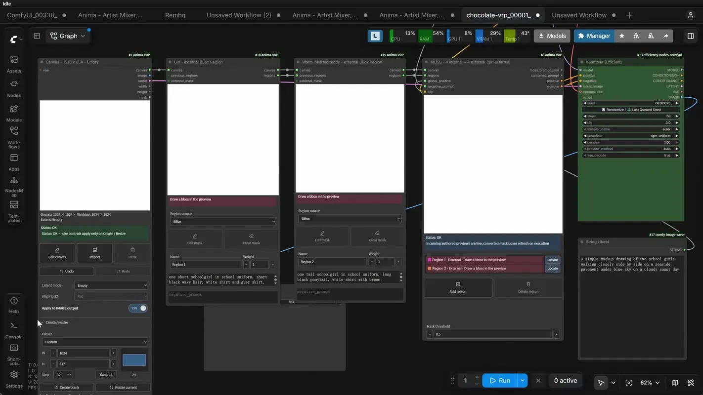](docs/images/demos/regional-sync.webp)
> 
> | 1>> Layout | 2>> Refine | 3>> Composition | 4>> Finish |
> |---|---|---|---|
> | Create a box-guided mockup with **MOSS VRP** | Bring it into an **Anima VRP** workflow | Reposition characters and refine the composition in **LuCiD Canvas** | (Re-)generate your image |


## Features

- **Versatile image loaders, built for img2img**: Start with an empty latent or load an existing image, and prepare your next generation without jumping between ComfyUI and external image editors. Resize your workspace, edit masks, step backward and forward through editing history, and handle latent encoding - all from a single node!

  | Create and Resize | Undo and Redo | Encode and Align |
  |---|---|---|
  | [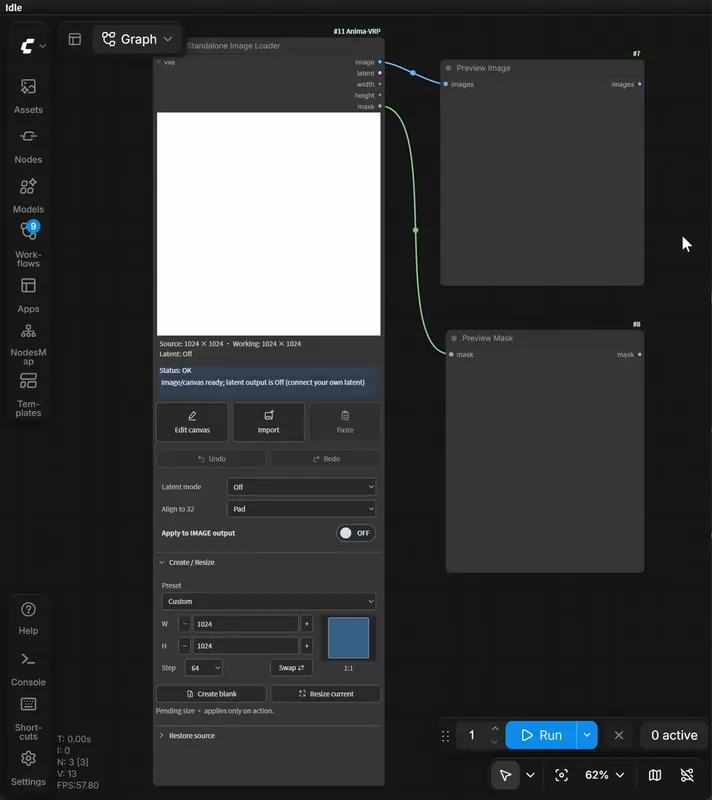](docs/images/demos/loader-resize.webp) | [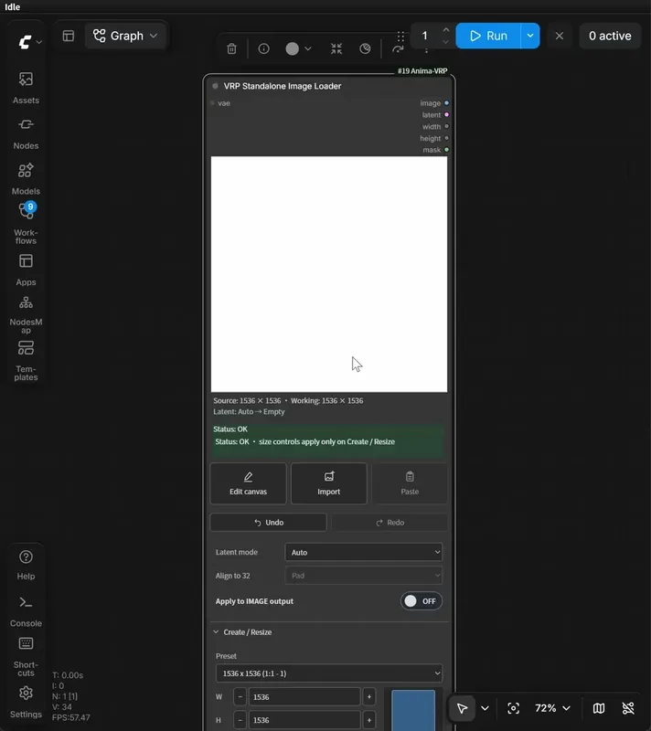](docs/images/demos/loader-undo-redo.webp) | [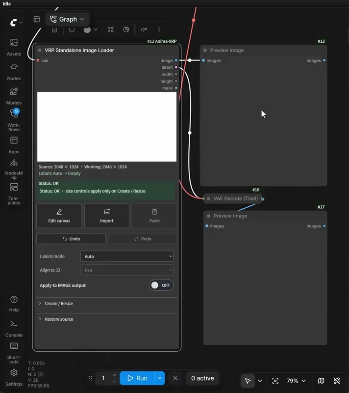](docs/images/demos/loader-latent.webp) |
  | Start fresh or resize your composition and mask together. Pick a preset or enter your own dimensions, with aspect preview. | Explore different starting points without losing your edits. Step backward and forward through saved image, paint, and mask states. | Choose a fresh latent or encode your loaded image, with tiled VAE support and automatic alignment options. |

- **LuCiD Canvas, a lightweight and powerful built-in image editor:** Build your composition right inside ComfyUI, from quick mockups to detailed img2img preparations, with a full set of editing tools at your fingertips. Import and combine image layers, paint, erase, and refine your composition with editable transforms, distortion, and reversible cropping - then bring your artwork straight back into the image loader!

  | Compose and Layer | Paint and Transform | Control and Customize |
  |---|---|---|
  | [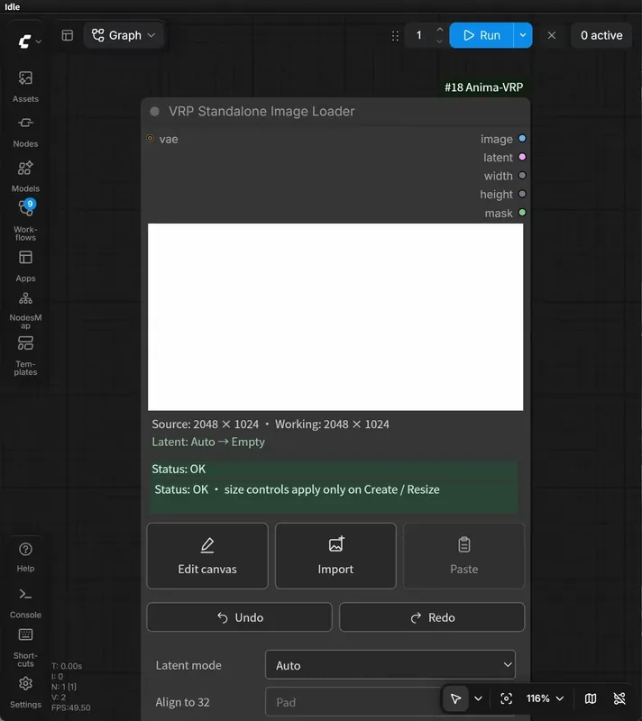](docs/images/demos/canvas-layers.webp) | [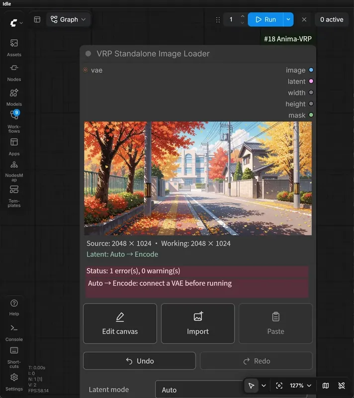](docs/images/demos/canvas-distort.webp) | [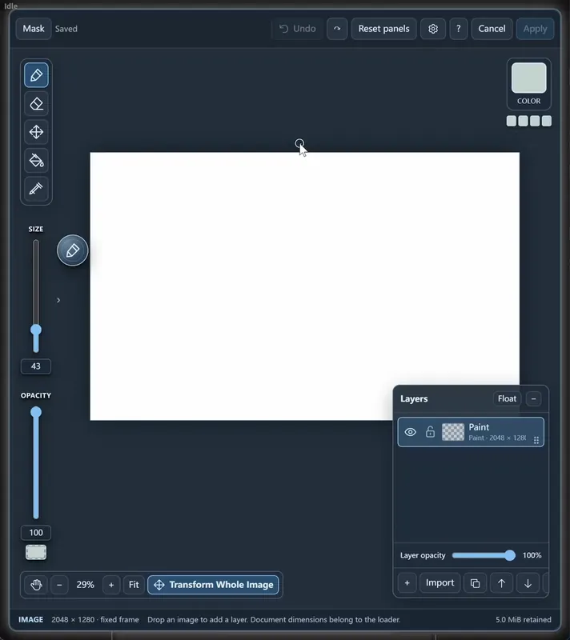](docs/images/demos/canvas-picker.webp) |
  | Build compositions from independent image objects and layers. Move, arrange, and crop elements non-destructively, with attached paint layers to keep your edits organized. | Paint, mask, erase, and transform your artwork using a focused set of editing tools. Make quick adjustments or reshape elements without permanently altering the originals. | Enjoy familiar, streamlined editing controls, with convenient brush controls, color picking...and more! Customize shortcuts and mouse interactions to your liking. |

- **Visual prompting for Anima and MOSS-Image**: Compose your regional layout through responsive visual controls, with flexible region organization and live feedback as you edit.

  [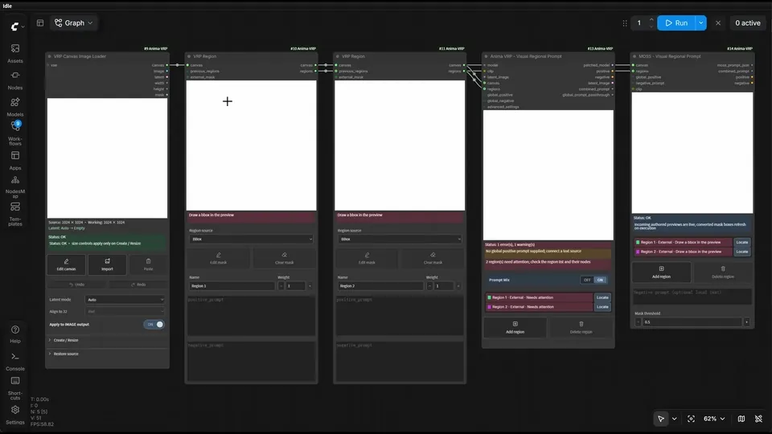](docs/images/demos/regions.webp)

  | Draw and Organize | Prompt and Guide | Encode and Connect |
  |---|---|---|
  | Draw, move, and resize boxes over your canvas. Keep regions inside one node or organize them into separate **VRP Region** nodes, with live layout previews. | Guide **Anima** with boxes or masks, regional positive/negative prompts, adjustable influence, and prompt mixing. Build **MOSS-Image** bbox layout prompts visually, without writing JSON or calculating coordinates. | Use built-in encoding for convenient sampler connections, or collect external Region prompts with **VRP Prompt Combine** for your own encoding or refiner branch. MOSS also exports native layout JSON for separate encoding. |

## Installation

### Prerequisites

- **ComfyUI with classic nodes enabled.** Current test setup: ComfyUI 0.42.0 + frontend 1.57.1. **Nodes 2.0 is currently unsupported**.
- **Python 3.11 or newer.**
- **For image-to-image latent encoding**: A VAE compatible with your generation model.
- **For Anima regional prompting**: An Anima-family model and compatible text encoders/VAE. Tested with the base model, base finetunes, and 2.9B finetunes. If you already have Anima setup and working, you already have the required models.
- **For MOSS-Image layout prompting**: A ComfyUI installation with **native MOSS-Image support**, MOSS-Image model weights, a compatible Qwen 3.5 text encoder, and a Flux.2 VAE. **Unofficial MOSS-Image workflows and custom nodes have not been tested**.

> [!NOTE] 
> **Older ComfyUI versions**
> 
> Anima regional prompting, the image loaders, and LuCiD Canvas were also tested with ComfyUI 0.32.0 + frontend 1.48.7 and ComfyUI 0.37.0 + frontend 1.53.6. Those versions lack native MOSS-Image support; update ComfyUI to use MOSS generation workflows.

The image loaders and LuCiD Canvas can be used independently of Anima and MOSS. No additional Python packages are required beyond your working ComfyUI environment. Image editing without latent encoding requires no model or VAE.

### Install from Comfy Registry

Open **ComfyUI Manager**, search for **LuCiD Visual Regional Painter** (`lucid-vrp`), and install it. Restart ComfyUI and refresh your browser.

Alternatively, with Comfy CLI configured for your ComfyUI installation:

```sh
comfy node install lucid-vrp
```

### Install from source

Clone the repository into your ComfyUI `custom_nodes` directory. For example, on Windows using PowerShell:

```powershell
cd "C:\path\to\ComfyUI\custom_nodes"
git clone https://github.com/EBEBEEBE/comfyui-lucid-vrp.git
```

Alternatively, download this repository as a ZIP and extract it into `ComfyUI/custom_nodes`. Your folder structure should look like this:

```Plain Text
ComfyUI/
└── custom_nodes/
    └── comfyui-lucid-vrp/
        ├── __init__.py
        ├── nodes.py
        ├── canvas.py
        ├── anima_regional.py
        ├── web/
        └── ...
```
> [!NOTE] 
> - For Windows portable installations, `custom_nodes` is inside the **inner `ComfyUI` folder**.
> 
> - The repository folder may also be named `comfyui-lucid-vrp-main` if downloaded from GitHub. As long as `__init__.py` is directly inside of it, the folder name does not matter.

Restart ComfyUI and refresh your browser. Find the nodes under **LuCiD VRP** in the Add Node menu.

## Quick Start

### Use VRP Image Loaders in an i2i Workflow

For a general-purpose `IMAGE` and `MASK` source for your workflow, use **VRP Standalone Image Loader**. Alternatively, start with **VRP Canvas Image Loader** when you also need a canvas for Anima regional prompting or MOSS-Image layout prompting.

- Press **Import** or drag an image file onto the loader to load an existing image or mockup, or use **Create blank** to start from scratch.
- Open **Edit canvas** to launch **LuCiD Canvas**. Import additional image layers, paint, transform, and arrange your composition.
- Press **Apply** to bring your edits back into the loader.

From here, `image` and `mask` outputs are ready to use with your existing ComfyUI workflows. For image/mask-only use, set latent mode to **Off** and leave `latent` disconnected.

For compatible models and workflows, the loader also offers built-in latent encoding, saving you the need for a separate VAE Encode node.
- Connect a compatible **VAE** and choose **Encode**, **Encode (Tiled)**, or **Auto**. Auto encodes imported images and RGB-painted blanks; an unpainted white blank uses Empty.
- Connect the loader's `latent` output to your sampler's `latent_image` input.
- Set **denoise** situationally. For empty latent (or the imported image is for reference only), set it to **1.0**; set it to **below 1.0** if you need the input image to steer the output image.

The rest of your generation workflow stays the same.

> [!NOTE]
> **Latent Compatibility**
> 
> The image loaders' `IMAGE` and `MASK` outputs are model-agnostic. Built-in latent encoding uses the connected VAE and will output latent in the corresponding format.
>
> **Empty** uses ComfyUI's standard empty-image placeholder; compatible native samplers adapt it to the connected model. Special pipelines or custom samplers may still need their own latent nodes. Working dimensions align to multiples of **32** by default.

For more details, see [Using Image Loaders](docs/image-loaders.md) and the [LuCiD Canvas manual](docs/canvas-tutorial.md).

### MOSS-Image SFT Layout Prompting Workflow

> [!TIP]
> The image below has the workflow embedded. Drag it into ComfyUI to load the example, then select your installed model files.

Start with a **VRP Canvas Image Loader**, the **MOSS - Visual Regional Prompt** node, and your working MOSS-Image SFT generation setup.

Create a blank canvas in **Empty** mode. Draw boxes directly in the MOSS node, or define them in separate **VRP Region** nodes connected to its **`canvas`** and **`regions`** inputs. Give each region its own positive prompt, and use the global prompt for the overall scene.

Connect your MOSS-compatible CLIP to the node, feed its **`positive`** and **`negative`** outputs to your sampler, and use the Canvas loader's **`latent`** as the starting latent.

[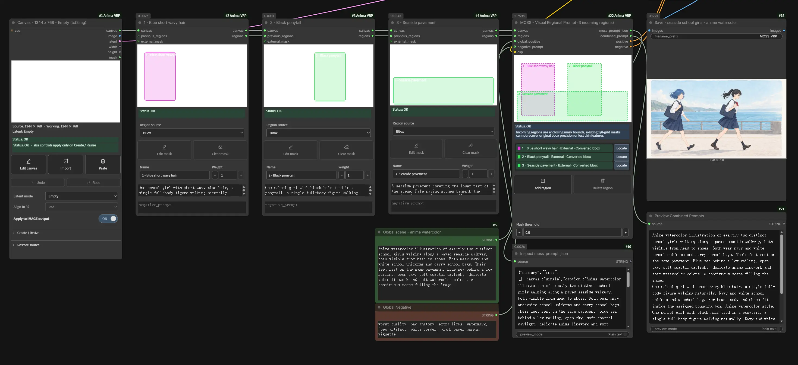](docs/images/workflows/moss-sft-layout.webp)

For more details, see the [MOSS layout guide](docs/moss-layout.md).

### Anima Regional Prompt Workflows

> [!IMPORTANT]
> Regional conditioning in Anima helps guide composition and associate prompts with particular areas, but placement is approximate, and prompts can still leak between regions.
>
> For more control over the starting composition, try the image-to-image workflow below and make the best use of **VRP Image Loaders** and **LuCiD Canvas**. Inpainting and other finishing steps require a separate workflow.

> [!TIP]
> 
> The images below contain embedded workflows. Drag them into ComfyUI to load corresponding workflow.

#### Image-to-Image + Anima Regional Prompting

Press **Import** on the VRP Canvas Image Loader to load a sketch, mockup, or existing image; or start with a blank canvas and paint a mockup.

Open **Edit canvas** and use **LuCiD Canvas** to build and refine your composition. Import additional images as layers, arrange and transform objects, paint adjustments, and crop or distort elements non-destructively. Once you're happy with your composition, press **Apply** to bring it back into the loader.

Connect a compatible VAE and leave latent mode on **Auto**, or select **Encode** explicitly. Connect the loader's `canvas` and `latent` to Core's `canvas` and `latent_image`, then define your regions. Connect an Anima-compatible CLIP onto Core, then feed Core's patched model, conditioning (optional), and latent outputs to your sampler, and use **denoise below 1.0** to retain influence from the starting image.

> [!TIP]
> MOSS-Image is incredibly good at image structure. Try constructing a mockup with MOSS, then use it as an i2i source in Anima - A good way to enjoy the best of both worlds.

[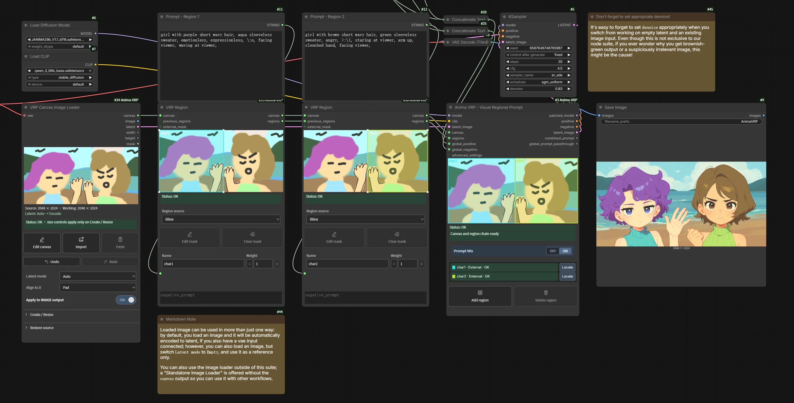](docs/images/workflows/anima-image-to-image.webp)

Example input image for this workflow can be found [here](docs/images/workflows/anima-image-to-image-input-file.webp).

For more on layer editing, painting, transforms, masks, and customization, check out the [LuCiD Canvas manual](docs/canvas-tutorial.md).

#### Using Internal Regions Only - Minimal Setup

Start with a **VRP Canvas Image Loader**, the **Anima VRP** core node,
and your usual Anima model loaders and sampler.

Create a blank canvas in **Empty** mode and connect the loader's `canvas` and
`latent` to Core's `canvas` and `latent_image`. Draw boxes directly inside Core
and select each region to edit its name, weight, and positive/negative prompts.
Core supplies the patched model, conditioning, and latent to your sampler.

[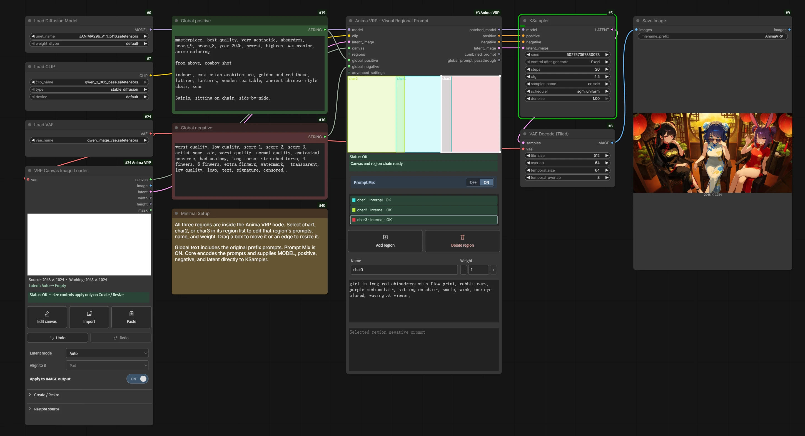](docs/images/workflows/anima-minimal.webp)

#### Using External Regions

Use a separate **VRP Region** node for each region. Choose a bounding box,
paint a mask with the native Mask Editor, or connect an external MASK.

Chain the Region nodes into Core, carrying **both `canvas` and `regions`**
forward. Connect each preceding `regions` output to the next node's
`previous_regions` input, then connect both final outputs to Core.

You can also combine external regions with boxes drawn inside Core.

[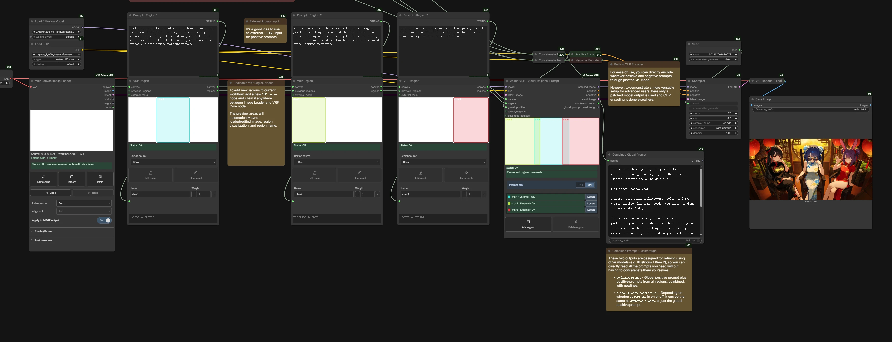](docs/images/workflows/anima-external-regions.webp)


## Documentation and examples

| Guide | What you'll find |
| --- | --- |
| [Node reference](docs/nodes.md) | Which node to use, its connections, and its outputs |
| [Using Image Loaders](docs/image-loaders.md) | Importing, painting, resizing, Undo/Redo, latent modes, and alignment |
| [LuCiD Canvas manual](docs/canvas-tutorial.md) | Layers, painting, transforms, distortion, reversible crop, and masks |
| [Canvas quick reference](docs/canvas-reference.md) | Editor controls, shortcuts, preferences, and saved state |
| [MOSS layout prompting](docs/moss-layout.md) | Internal/external boxes, scene prompts, encoding, and MOSS conversion limits |
| [Regions and prompts](docs/regions.md) | Internal boxes, external Region chains, masks, and Prompt Mix |
| [Advanced settings](docs/advanced-settings.md) | Regional routing presets, controls, and performance tradeoffs |
| [Configuration](docs/configuration.md) | Custom resolution presets, colors, layout, and starting regions |
| [Troubleshooting](docs/troubleshooting.md) | Common errors and what to check |
| [Compatibility and limitations](docs/limitations.md) | Supported setups and current boundaries |

## Known limitations

- **Classic ComfyUI only.** Nodes 2.0 is currently unsupported.
- **Regional guidance is approximate.** Anima regions and MOSS-Image layout
  boxes help steer composition; they do not guarantee exact placement,
  prevent all attribute leakage, or lock pixels.
- **MOSS-Image support is experimental.** Incoming masks become enclosing
  rectangles. Regional negatives and fractional region weights are not
  supported; negative prompting applies globally.
- **Not included in this release:** masked inpainting, regional LoRA, and built-in ControlNet integration. Use separate nodes or workflows for these features for now.
- **Anima attention patches may conflict with other extensions** that
  modify the same attention operations.
- **Saved workflows are not self-contained image documents.** Keep referenced
  images, masks, and Canvas layer assets alongside your workflow to reopen
  saved edits and history.

See [compatibility and limitations](docs/limitations.md) for details.

## Acknowledgements

- [Sen-sou's ComfyUI-Anima-Regional-Conditioning](https://github.com/Sen-sou/Comfyui-Anima-Regional-Conditioning) - the foundation for VRP's adapted Anima regional-conditioning logic.
- [OpenMOSS / MOSS-Image](https://github.com/OpenMOSS/MOSS-Image) - the model and documented native layout-prompt format used by VRP's MOSS integration.
- [ComfyUI](https://github.com/Comfy-Org/ComfyUI) and
  [ComfyUI_frontend](https://github.com/Comfy-Org/ComfyUI_frontend) - the host APIs, classic node interface, native text/VAE encoding and sampling, Clipspace, and the stock Mask Editor used for Region masks.
- Development references: [sd-forge-couple](https://github.com/Haoming02/sd-forge-couple)
  for bounding-box interaction,
  [Anima-Artist-Mixer](https://github.com/An1X3R/Anima-Artist-Mixer)
  for model-wrapper behavior, and
  [ComfyUI-Lora-Manager](https://github.com/willmiao/ComfyUI-Lora-Manager)
  for frontend lifecycle and event patterns.
- [ComfyUI Prompt Control](https://github.com/asagi4/comfyui-prompt-control)
  and [Regional-Prompting-FLUX](https://github.com/instantX-research/Regional-Prompting-FLUX)
  were studied as behavior/API and conceptual references, respectively.
  Prompt Control's implementation is not copied or used by VRP.

Adapted-code notices and notes on host integration and development references are recorded in [Third-party notices](THIRD_PARTY_NOTICES.md).

## License

LuCiD VRP's project-authored software and documentation text, including
**LuCiD Canvas** and the **MOSS layout node**, are licensed under the
[MIT License](LICENSE). Adapted third-party code retains its applicable
copyright and license notices; see [Third-party notices](THIRD_PARTY_NOTICES.md).

Models, text encoders, and separately installed host projects retain their own
terms. 
