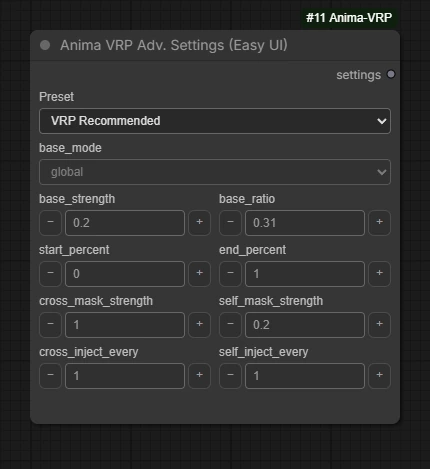

# Advanced regional settings

[Introduction](../README.md) · [Node reference](nodes.md) · [Troubleshooting](troubleshooting.md)

Start with Core's defaults. Connect either **Anima VRP Adv. Settings (Easy UI)** or
**Anima VRP Adv. Settings (Simple UI)** only when you want to change regional routing.
Their output, `settings`, connects to Core's `advanced_settings` input.
The two presentations produce the same settings.

These controls affect the regional model patch. Sampler, steps, CFG, seed,
and denoise remain on your normal sampler.
These settings apply to **Anima Core**. The MOSS layout node has no
`advanced_settings` input and does not use this regional attention patch.

## Presets

| Preset | Behavior |
| --- | --- |
| VRP Recommended | Current VRP defaults; also used with no settings node connected |
| Sen-sou Upstream Defaults | The upstream reference parameter set retained for comparison |
| Custom | Uses your editable values |

Fixed presets display their values but keep them read-only. Choose Custom to
edit; returning to Custom restores its last edited values.

| Setting | VRP Recommended | Sen-sou Upstream Defaults |
| --- | --- | --- |
| `base_mode` | global | disabled |
| `base_strength` | 0.20 | 0.20 |
| `start_percent` | 0.0 | 0.0 |
| `end_percent` | 1.0 | 0.35 |
| `cross_mask_strength` | 1.0 | 1.0 |
| `self_mask_strength` | 0.20 | 0.20 |
| `base_ratio` | 0.31 | 0.10 |
| `cross_inject_every` | 1 | 1 |
| `self_inject_every` | 1 | 1 |

## What the controls mean

| Setting | Range | Effect |
| --- | --- | --- |
| `base_mode` | global / uncovered_only / disabled | Where the base/global text slot participates in regional attention |
| `base_strength` | 0–10 | Base spatial-penalty strength; the current attention implementation clamps effective strength to 0–1 |
| `start_percent`, `end_percent` | 0–1 | Sampling-progress window in which the regional patch is active |
| `cross_mask_strength` | 0–1 | Strength of spatial restrictions between image positions and text slots |
| `self_mask_strength` | 0–1 | Enables self-attention restrictions at positive values in non-global base modes |
| `base_ratio` | 0–1 | Blend weight of an extra original-model result |
| `cross_inject_every` | Integer 1–100 | Apply regional cross-attention routing every N model blocks |
| `self_inject_every` | Integer 1–100 | Apply the selected self-attention operation every N model blocks |

Start must not exceed end. The window follows ComfyUI's model-sampling
progress conversion, not a count of workflow runs.

### Base routing versus base blending

These are separate controls:

- **global** lets the base text participate across the image.
- **uncovered_only** gives the base slot the area outside the regional union.
- **disabled** removes the normal base mask. Positions with no permitted text
  still fall back to the base slot.

`base_strength` controls spatial penalties; it is not a global-prompt text
multiplier. `base_ratio` instead blends the original-model prediction with
the regional prediction. At 0 only the regional result remains; at 1 only the
original-model result remains, although the regional pass is still computed.

The original-model pass uses the conditioning supplied to the sampler. With
Prompt Mix ON, that conditioning already includes the mixed regional positives.
It is not necessarily a global-only comparison.

### Mask strengths and intervals

At `cross_mask_strength = 0`, positive regional text loses its spatial penalties.
This does not remove regional text or bypass VRP. CFG slot isolation and
regional-negative membership still apply.

Self-attention restrictions are currently binary once enabled in a non-global
mode; do not expect a smooth blend between 0.2 and 0.8. In global mode there is
no spatial self-attention restriction.

Injection intervals count **model blocks**, not sampler steps. A value of 1
uses every eligible block. Larger cross intervals use base-only text on the
intervening blocks; larger self intervals leave intervening self operations
unchanged. These are behavior changes, not guaranteed speed presets.

## Performance

When regional routing is active, any positive `base_ratio` triggers an extra
original-model call. A value of 0.01 still requests that pass. The default 0.31
is a blend weight, not a 31% cost increase.

For a useful comparison, keep the model, seed, dimensions, region prompts,
batch size, sampler, steps, CFG, denoise, and other patches fixed. Compare
ordinary Anima and VRP after warmup, then try VRP with `base_ratio = 0` as a
separate output-changing experiment. Measure VAE preparation and sampling
separately.

Patched attention calls PyTorch scaled dot-product attention directly. A
ComfyUI Flash/Sage choice does not automatically select that backend here.
Actual kernel availability and speed depend on the installed runtime and
hardware; this guide promises no fixed speed ratio.

Settings can change composition and attribute separation. Change one at a
time and compare outputs. The default preset is a starting point, not a claim
of best settings for every checkpoint or scene.
