# LuCiD Canvas user manual

[Image loaders](image-loaders.md) · [Quick reference](canvas-reference.md) · [Configuration](configuration.md)

LuCiD Canvas is the layered image editor used by the two standard VRP image
loaders. It combines image placement, paint, reversible geometry edits and an
independent mask for preparing an img2img source or an image/mask workflow.

This manual is organized by editor feature. Each section explains the controls
and their behavior; short examples show where those features are useful. You can
read it in order or go directly to the module you need.

| Module | What it covers |
| --- | --- |
| [Opening the editor](#opening-the-editor) | Loaders, source imports and the fixed output frame |
| [Workspace and navigation](#workspace-and-navigation) | Interface areas, zoom, pan and panel placement |
| [Layers](#layers) | Selection, visibility, locks, ordering and attached paint overlays |
| [Brush and Eraser](#brush-and-eraser) | Size, opacity, hardness, brush tips and Quick brush |
| [Color](#color) | Picker, HEX entry, recent colors and temporary sampling |
| [Fill](#fill) | Connected areas, Threshold and Fill through |
| [Transform](#transform) | Move, scale, rotate, flip, All content, Distort and Crop |
| [Mask](#mask) | Coverage painting, preview settings, grow/shrink and outputs |
| [Preferences and input](#preferences-and-input) | Right-button styles, shortcuts and automatic recall |
| [Apply, history and saved files](#apply-history-and-saved-files) | Drafts, the two Undo scopes, reopening and workflow resources |

## Opening the editor

### Choose a loader

Use **VRP Canvas Image Loader** when the document also defines the canvas for
regional prompting. Use **VRP Standalone Image Loader** for the same image-editing
tools without a regional canvas output.

Import an image into the loader, or use **Create blank** in its **Create / Resize**
section. Press **Edit canvas**, or choose **Edit Image** in the loader's
right-click menu, to open LuCiD Canvas.

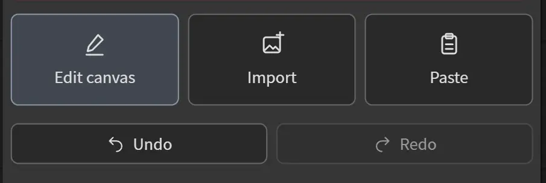

Image-only editing with the Standalone loader's latent mode set to **Off** needs
no model or VAE. Encoding the edited source for img2img needs an appropriate VAE.
The [image-loader guide](image-loaders.md) explains those output choices.

### Source imports and layer imports

The location of an import determines its purpose:

| Import location | Result |
| --- | --- |
| On the loader | Replaces its active source document |
| Inside Canvas, using the Layers panel's Import or an image drop | Adds an image layer to the current document |

Inside Canvas, imports accept PNG, JPEG and WebP. They retain native source
pixels and initially scale to fit within the frame. A transparent character PNG
can therefore sit over a separate background without replacing it.

### The fixed output frame

The loader owns document dimensions. Canvas edits the artwork **inside that
frame**; it does not resize the document.

| Operation | What changes |
| --- | --- |
| Zoom / pan | Your view of the document |
| Layer Transform | Placement and shape of an object |
| Transform Whole Image / All content | Placement of the whole composition |
| Layer Crop | The visible portion of an object |
| Loader Resize current | Output dimensions and the composition's fit to the new frame |

For example, enlarging a full-body character until the legs fall outside a
2048 × 1024 frame changes the shot, while the output remains 2048 × 1024.
[Transform](#transform) explains that operation.

Edits remain a draft until **Apply**. **Cancel** discards the draft's image
changes. See [Apply and history](#apply-history-and-saved-files) before closing
an editing session.

## Workspace and navigation

### Interface areas

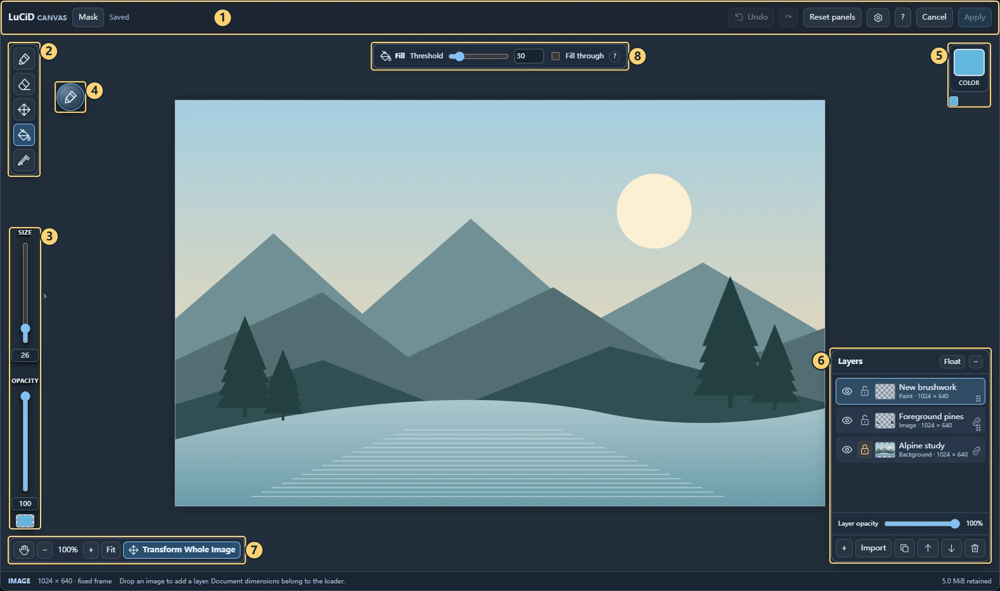

Fill is active in this view so the contextual top bar (8) is visible. Transform
shows its own settings in the same area.

| # | Area | Purpose |
| --- | --- | --- |
| 1 | Header | Image/Mask toggle, edit status, Undo/Redo, Reset panels, gear, help, Cancel and Apply |
| 2 | Left toolbar | Brush, Eraser, Transform, Fill and Eyedropper |
| 3 | Left rail | Size, Opacity and a normally hidden Hardness control |
| 4 | Floating brush ball | Quick brush controls near your work |
| 5 | Upper-right color controls | Current paint color and recent swatches |
| 6 | Layers / Mask panel | Layer operations in Image mode; selection controls in Mask mode |
| 7 | Lower-left controls | Hand, zoom out/in, zoom level, Fit and Transform Whole Image |
| 8 | Contextual top bar | Settings for Transform or Fill when that tool is active |

The active tool and selected layer are independent. Switching tools does not
choose a different object. Check the highlighted layer row before painting or
transforming.

### Zoom and pan

- Scroll over the canvas to zoom around the pointer.
- Hold **Space + drag**, or use a middle-button drag, to pan.
- Enable **Hand** beside the zoom controls to pan with left drag. Toggle it off
  to resume the current tool; a pending transform round stays intact.
- Use **Fit** to bring the whole frame back into view.
- The **+ / −** buttons beside the zoom percentage offer another way to zoom.

Zooming does not change brush settings, source resolution or output dimensions.
If a transform handle is outside the visible area, zoom out or pan to reach it.

### Docking, floating and resetting panels

Use **Float** to release the Layers or Mask panel from its dock, then drag the
panel header to move it. **Dock** returns it to the dock. The small **−** button
collapses a panel when you need more room.

Image and Mask panel layouts are remembered separately. The floating brush ball
can also be dragged. **Reset panels** in the header restores panel and ball
placement if a layout becomes inconvenient.

## Layers

### Layer types

A layer keeps one part of the composition separate from the others. Rows higher
in the Layers list appear in front of lower rows.

| Type | Use and behavior |
| --- | --- |
| Background image | The loader's source. New imports allow transforms by default; original pixels stay read-only. It cannot be deleted. |
| Imported image | A separately placed image with retained source pixels and editable geometry. |
| Independent paint layer | Paint that should move and be edited independently of an image. Create it with **+** or **Shift+N**. |
| Attached paint overlay | One paint child belonging to an image. It follows that image's geometry and appears as an indented row. |

The document's independent mask is managed in [Mask mode](#mask), rather than as
another layer in this list.

A new blank document starts with one editable paint layer over the white frame.
A source imported through the loader starts with Background and an independent
Paint layer; they have no automatic parent/child relationship. Existing saved
documents retain their layers and lock flags when reopened.

### Selecting an editing target

Click a row to make it active. In Image mode, **Ctrl+Click / Cmd+Click** on the
canvas selects the topmost visible, paint-capable hit under the pointer.
When an image has a usable paint overlay, the gesture selects that child.

This gesture keeps your current tool and consumes the click without painting.
A miss retains the current selection. Selection alone creates no overlay or Undo
entry. Hidden, paint-locked and zero-opacity targets are skipped. An image's
transform lock does not prevent selecting its unlocked paint child.

A context menu has its own action target: right-clicking an object does **not**
automatically make it your next paint target. To switch deliberately, select its
row or use the modified click above.

### Visibility, lock and opacity

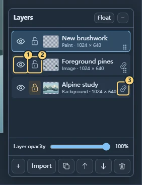

1. **Eye:** hide/show the layer without deleting its pixels.
2. **Lock:** protect image geometry or paint edits, depending on layer type.
3. **Attachment icon:** manage the paint overlay belonging to an image.

The **Layer opacity** slider affects the selected layer's overall contribution.
It is separate from brush opacity, which controls new marks. An image's
visibility, crop and object opacity also govern its child; the child retains
its own visibility, paint lock and opacity controls.

An image's **transform lock** blocks moving, scaling, rotating, distorting and
cropping the pair. It does not prevent painting on an unlocked child. A child's
**paint lock** protects its pixels; shared transforms still use the parent's
lock. An independent paint layer's lock protects both pixels and geometry.
If a lock blocks an action, the notice names the blocking layer and its lock
icon blinks and shakes. Reduced-motion settings suppress the shake.

#### Example: separate foreground trees

In the hills scene, the pines are above the landscape. Hiding their row reveals
the hills without changing that background:

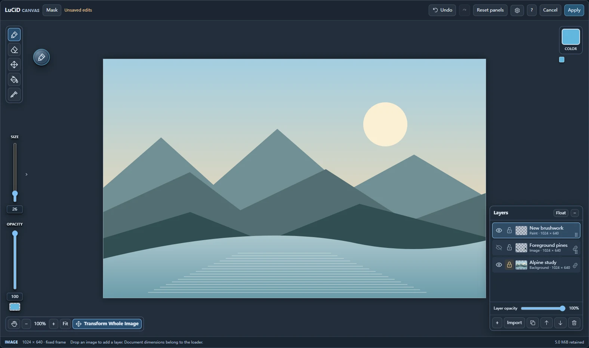

This is useful for checking a composition, comparing paint alternatives, or
temporarily removing foreground clutter. Show the row again to restore it.

### Creating, renaming, duplicating and deleting

Use **+** for an independent paint layer and **Import** for another image.
Right-click a row for **Rename layer**, **Duplicate layer** and **Delete layer**;
the lower panel buttons also provide duplication and deletion.

With focus in the Layers panel, **Delete** acts on the selected layer. Protected
or locked targets show a notice instead. Delete inside a text field still edits
that text; it is not a canvas-wide delete shortcut.

Deleting an image removes its attached paint child with it. Duplicating an image
copies the image/child pair. The protected background cannot be deleted. A paint
lock blocks deletion of that paint, including deletion through its parent. An
image's transform lock does not block opacity, ordering or deletion. Use Undo
to reverse an accidental operation.

### Ordering layers

Drag a row by its grip to reorder it. The insertion line and action label show
where the object will go; check them before releasing. The up/down buttons offer
ordinary reordering without dragging.

An image and its child move through the list as one object. Dragging a child
onto a root insertion line **detaches** it and changes its order in one Undo
operation. Use the row menu if you want an explicit detach command instead.

### Attached paint overlays

An attached overlay is paint that belongs to an image. Select an imported image
and start painting: the first effective paint edit creates its child. Merely
selecting the image, picking a color or attempting to erase an image without a
child does not create one. **Add paint overlay** in the image menu creates an
empty child explicitly.

Background is an exception: painting on it never creates a child automatically.
Use the independent Paint layer, or explicitly **Add paint overlay** or attach
paint to Background when it should follow that image's geometry.

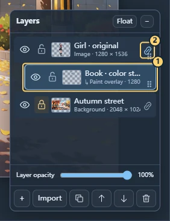

1. The indented row is the paint overlay.
2. The image's active attachment icon indicates that a child exists; clicking it
   selects that child.

The original image remains underneath. Hiding or erasing the child reveals those
original pixels. Transforming either member targets the image/overlay object
together, so the paint follows movement, scale, rotation, distortion and crop.

#### Example: a book-cover color correction

Select the girl's image, use a small hard brush, and paint a color block on the
book. Name the resulting child **Book · color study**. The close-up shows the
paint confined to the upper cover, leaving the hands and jacket clear:

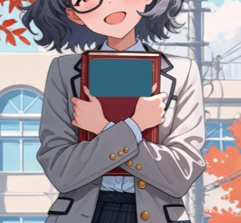

After the image is enlarged or rotated, the cover paint stays aligned:

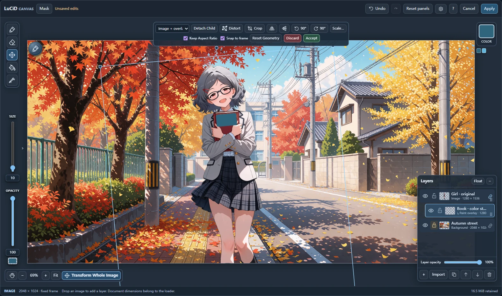

The same feature can hold a hair correction or lighting paint. This version
supports **one child per image**; these edits share it. The child is not an
automatic alpha lock: paint can extend beyond the image's opaque silhouette.
Erase spills from the child when needed.

### Detaching and attaching existing paint

**Detach paint overlay** makes a child independent while retaining its current
geometry. Future edits to the former parent no longer carry it along. Inherited
opacity is carried over, though overlapping translucent pixels can look
different outside the image object.

While transforming an **Image + overlay** pair, **Detach Child** in the toolbar
also selects the detached paint and keeps Transform active. The next drag edits
that paint alone. It leaves shared Crop/Distort editing mode without removing
the inherited geometry. Undo restores the attachment in one step. Only the
child's own paint lock blocks detachment; the parent's transform lock can stay on.

To attach independent paint, drop its row onto the image's attachment icon, or
choose **Attach to image… / Attach paint layer…** in the appropriate row menu.
The destination image must have no existing child.

Empty paint attaches immediately. Nonempty paint also attaches without a warning
when its current geometry can follow the image through a local offset alone.
These operations preserve the existing source pixels.

Otherwise **Bake and attach** asks before resampling the current geometry into
new paint pixels and establishing a new local baseline. Detail can soften. A
scaled or distorted destination can require this conversion even if the paint
itself has no transform. Undo restores the previous pixels, geometry and
relationship; the editor's Undo history is not cleared.

## Brush and Eraser

### Choosing the tool and target

Choose **Brush (B)** to add paint and **Eraser (E)** to remove it. On an
independent paint layer, both affect that layer only. On an imported image,
painting uses its attached overlay; erasing removes overlay paint rather than
the original image.

For RGB paint, make sure the intended paint row is selected and its own paint
lock is off. Its parent may remain transform-locked. In Mask mode, the same tools add/remove independent selection
coverage instead of RGB paint; they do not depend on the active image layer.

### Size, opacity and hardness

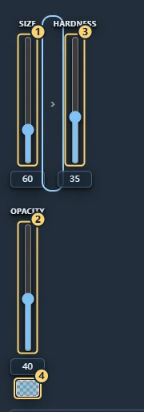

1. **Size:** brush diameter, from **1 to 250**.
2. **Opacity:** the strength of new paint or erasing.
3. **Hardness:** the edge falloff, from soft at 0% to hard at 100%. Reveal it
   through the chevron immediately to the right of Size.
4. **Opacity preview:** a checker-backed swatch showing the paint's transparency.

Size sits above Opacity in the left rail. Hover or focus the chevron to expose
Hardness; it normally stays hidden. Use a slider, enter a numeric value, or scroll
over the relevant control.

Brush opacity affects marks as you make them. Reducing it afterward does not
change earlier strokes; use **Layer opacity** for the whole layer. Repeated
non-opaque strokes can build coverage.

### Brush tips and Quick brush

Click the floating brush ball to open **Quick brush**, or move the pointer near
your work and press **F** to summon it there.

F's placement is temporary: Escape or an outside click closes the panel and
returns the ball to its last deliberately dragged position. The outside click
and any drag before releasing it only dismiss the panel; the next fresh press
can paint. Brush settings changed in the panel remain applied.

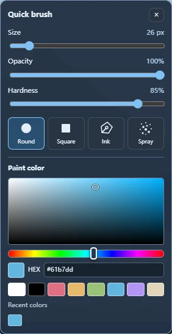

This panel combines Size, Opacity, Hardness, brush-tip choices and, in Image mode,
the color picker. Its controls change the same brush settings as the rail.

Available tips are **Round, Square, Ink and Spray**. Round is a useful starting
point for sketching and soft paint; Square and Ink provide alternative marks.
Spray builds coverage while the pointer is held down, rather than acting only
as a single dab.

### Example: soft paint for lighting

Low opacity and hardness let you introduce a lighting cue while keeping clothing
folds visible. Select the character image or its paint child, choose Round, and
make a few strokes on the areas you want to affect. The image's overlay keeps
that paint with the character.

For warm autumn light, the example uses amber `#efb65f`, Size **150**, Opacity
**23%** and Hardness **8%**, brushed onto the hair and shoulders:

| Before | Warm overlay paint |
| --- | --- |
| 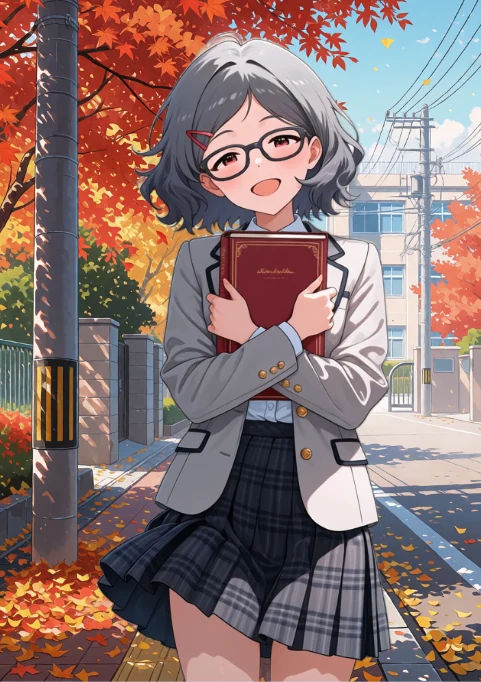 | 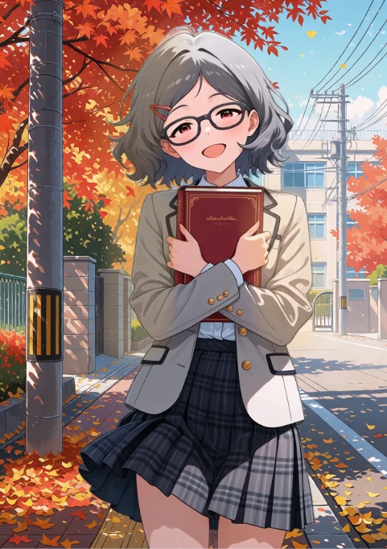 |

For the summer street's cool shadows, the example uses blue `#477fae`, Size
**170**, Opacity **28%** and Hardness **5%**, over the shadow-side hair, sleeves
and skirt:

| Before | Cool overlay paint |
| --- | --- |
| 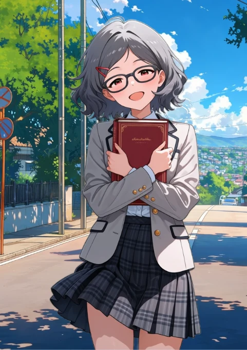 | 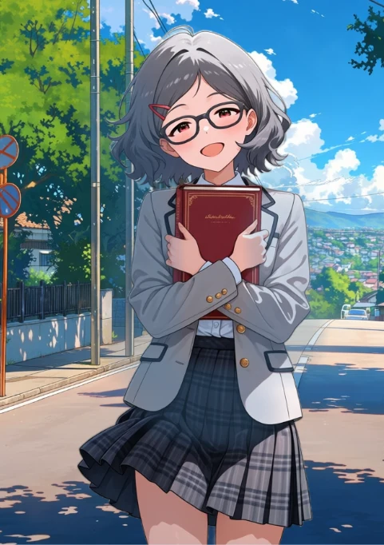 |

These are starting values for the shown placement, not presets or automatic
relighting. Adjust the brush to your scale, build gradually, and check at Fit.
Use Undo or the child's opacity if the effect becomes too strong. Keep strokes
inside the silhouette unless you want paint outside it.

### Off-frame paint

Paint outside the output frame is retained so it can return when you move the
layer. Only the fixed frame contributes to the applied image. This retained
content still uses memory; large off-frame edits and native image sources can
reach the editor's safeguards even with a small visible frame.

## Color

### Choosing a color

Open the upper-right color swatch with **C**, or use the color controls inside
Quick brush. Drag in the color field to choose saturation/brightness, adjust the
hue slider, enter a HEX value, or choose a preset swatch.

Recent swatches recall up to **ten colors**. The small color dock shows a subset;
the full recent palette is in the picker. These colors are remembered across
editor sessions.

### Eyedropper and temporary picking

Choose **Eyedropper (I)** to sample the visible RGB composite. Alternatively,
hold **Alt** while using Brush, Eraser or Fill to sample temporarily, then release
it to resume the same tool. Preferences offers **Q** or **Off** instead.

Sampling creates no paint or overlay, and excludes the mask-preview tint.
Temporary picking is available in Image mode; Eyedropper is hidden in Mask mode.
If your browser/OS intercepts Alt, choose Q—the editor cannot reliably detect
interception.

For the lighting example, sample a warm or cool tone from the background before
painting on the character's overlay. Sampling the background does not select it
as your paint target.

## Fill

Choose **Fill (G)** to paint a connected area. Its toolbar appears at the top
of the workspace.

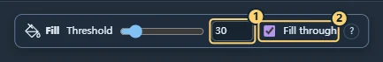

1. **Threshold:** connected-color tolerance, from 0 to 255. Zero matches exactly;
   larger values allow greater differences between neighboring colors.
2. **Fill through:** chooses whether boundaries come from the visible composite
   rather than just the active layer or mask.

| Reference mode | Where boundaries come from | Where the result is written |
| --- | --- | --- |
| Fill through off, Image mode | The active layer | The active paint layer or image's paint child |
| Fill through off, Mask mode | Existing mask coverage | The independent mask |
| Fill through on | Visible RGB composite | The active paint target or independent mask |

On an empty paint layer, its transparent pixels can form one connected area
covering the whole frame. Enable Fill through when the desired boundary belongs
to the picture underneath. Fill is contiguous color matching, not object
recognition.

### Example: change the lake color separately

Create an empty paint layer above the landscape, choose a blue-green color, turn
on Fill through, and click the lake. The visible hills and water provide the
boundary while the fill is written to the new layer:

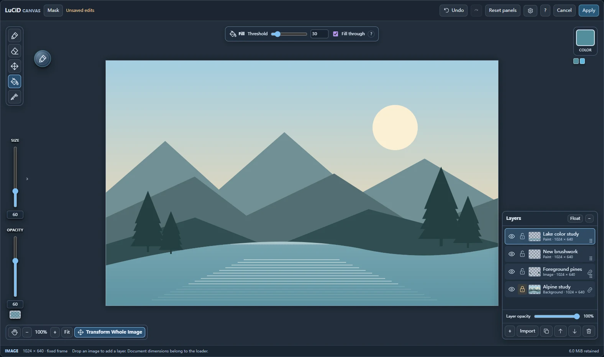

Start with a modest Threshold. If a shaded area fills only in patches, increase
it a little. If it spreads too far, Undo, reduce Threshold, and try again. Hiding
the study layer restores the original appearance.

## Transform

Choose **Transform (V)** after selecting the object you want to edit. Its
toolbar and handles appear. Geometry remains editable after Apply and reopening;
leaving the tool does not flatten the object.

### Target and basic controls

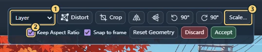

1. **Target:** Layer, Image + overlay, or All content.
2. **Keep Aspect Ratio:** keep proportions while scaling; hold Shift to temporarily release
   the constraint.
3. **Scale…:** multiply the current size by a percentage, from 1% to 1000%.

| Action | Control |
| --- | --- |
| Move | Drag inside the transform outline, away from the handles |
| Scale | Drag a corner handle |
| Rotate freely | Drag the circular handle above the top edge |
| Rotate in 15° steps | Hold Shift while rotating |
| Flip horizontally / vertically | The two flip buttons |
| Rotate 90° counterclockwise / clockwise | The two 90° buttons |
| Reset placement and distortion, preserving Crop | Reset Geometry |
| Keep this transform round and return to the previous tool | Accept / Enter |
| Discard this transform round and return to the previous tool | Discard / Escape |

For an attached child, the target becomes **Image + overlay** and both follow
the image's geometry. Ordinary Transform encloses the image and its visible paint
overlay, including retained paint extending outside the image. **Accept** keeps
the round's changes without applying the editor session. **Discard** restores
the entry state and its Undo/Redo history, including changes made with Crop,
Distort and toolbar detachment. Crop has its own **Reset crop** command.

An unchanged round exits when you click outside or switch tools/layers. With
pending changes, these attempts expand a reminder beneath the toolbar: choose
Accept or Discard to continue. The blocked action is not replayed. A 12-screen-
pixel margin protects the transformed outline; handles remain protected too.
Outside drags do not trigger the reminder. Pan and zoom remain available over
handles, and right-button input cannot erase during Transform. Open popups and
text fields handle their own keys first.

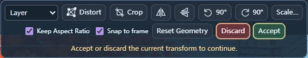

Use **Detach Child** beside the target selector when you want to transform the
paint independently. It detaches and selects the child while leaving this tool
active. It is unavailable for All content or a layer without an attached child.

### Example: reframe a full-body image

Before reframing, **Snap to frame** can help place an object against an output
edge. See [movement snapping](#movement-snapping) for its controls.

A transparent full-body character initially fits inside the background frame:

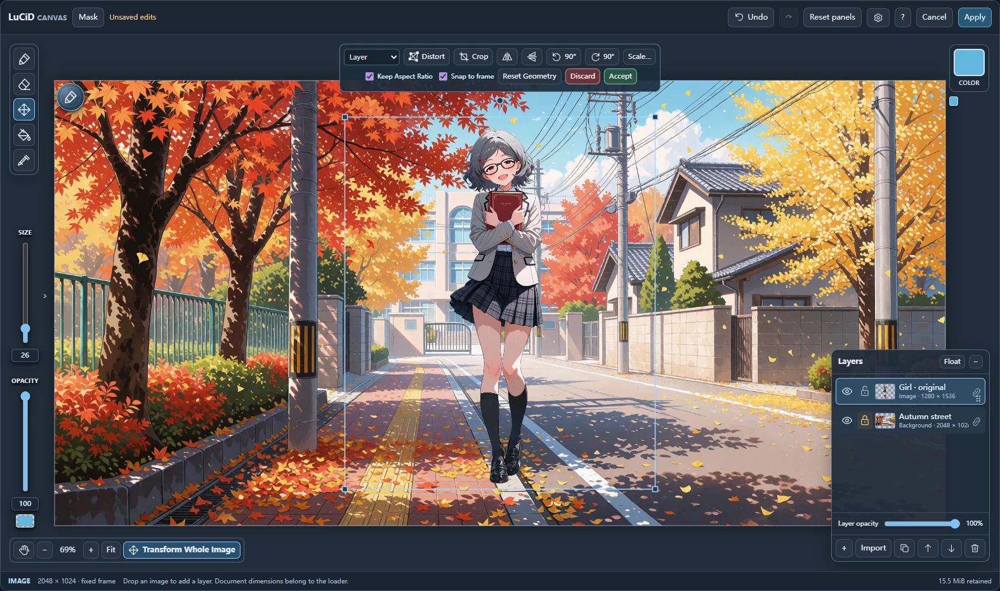

Keep Aspect Ratio enabled, enlarge her, then move her down and slightly left until the
frame cuts through the upper thighs. This produces a cowboy-shot-style mockup:

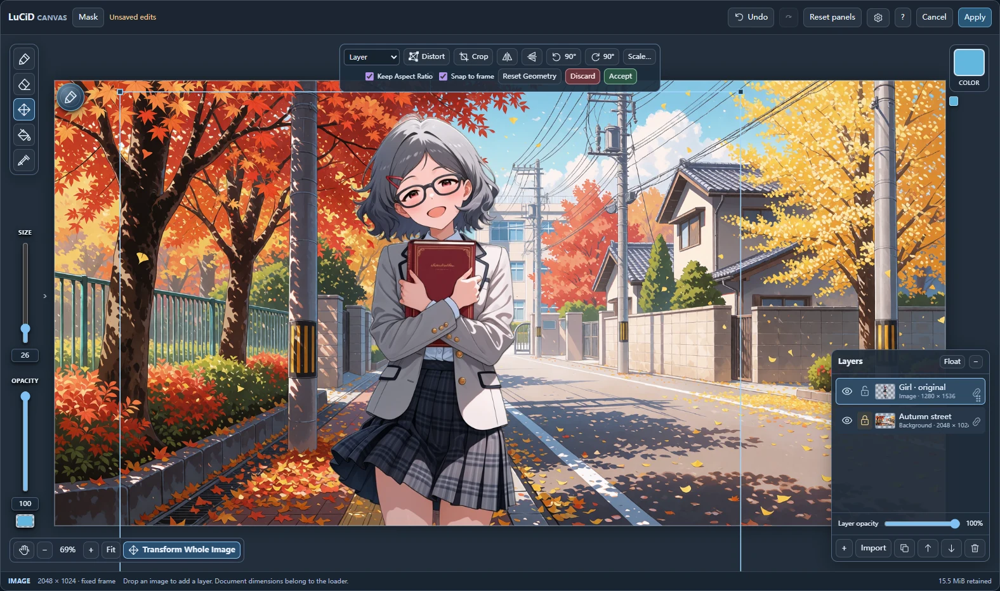

The capture starts from the fitted import, scales it to 110%, then by a further
200%, and adjusts placement. Judge your own framing visually; percentages are
relative to the current size. The legs remain in the source, so shrinking or
moving the image can reveal them again.

### Movement snapping

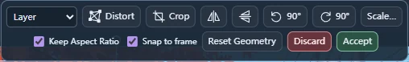

**Snap to frame** is enabled initially and remembers your last choice. While
moving an object, its transform bounds align with the four output-frame borders
within six screen pixels. An engaged border glows gold; dragging farther releases
it, so objects can still move outside the frame. The tolerance stays consistent
when you zoom.

The image and its attached paint move as one target. Snapping uses the displayed
transform box, including transparent padding and any retained child extents.
**All content** uses its shared frame box. Toggle changes create no image Undo
entry and survive Cancel. The completed move remains one Undo operation.

Snapping affects movement only. Scaling, rotation and Crop/Distort corner handles
remain free. Move the object with Transform to align an already cropped or
distorted object; there is no object-to-object, center or grid snapping.

### All content and Transform Whole Image

**Transform Whole Image** at the lower left, or **All content** in the target selector,
treats the composition as one temporary transform target. Move, scale and rotate
its contents inside the unchanged output frame.

This target includes locked layers, allowing a protected background to follow
the whole composition. **Include mask** explicitly chooses whether the authored
mask follows too. Individual Distort and Crop controls are unavailable while
All content is selected.

#### Example: a Dutch angle

Choose All content, rotate a little, then enlarge the composition enough to
cover the exposed frame corners. 

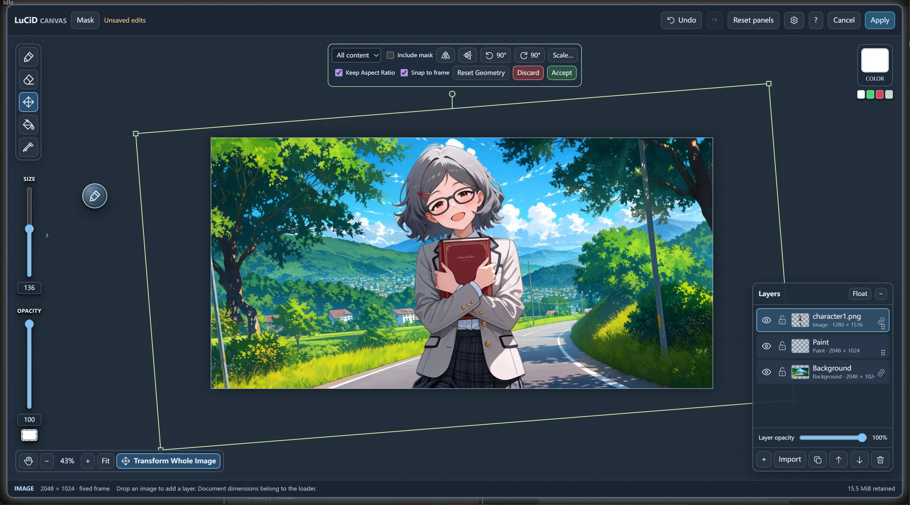

Both the street and girl tilt, while the frame stays level at 2048 × 1024.
Press Accept to keep the whole-composition transform, or Discard to restore its entry state.

### Distort

**Distort** changes the selected object's four corners independently. Select an
individual object, enable Distort, and drag a corner. Keep the shape convex:
crossed corners and collapsed edges are rejected.

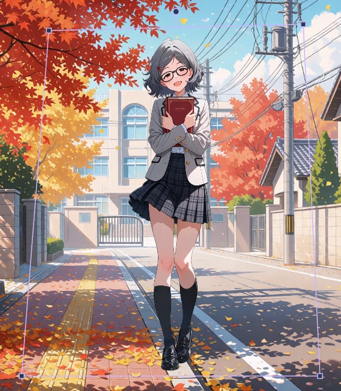

Small upper-corner changes can suggest perspective in a layout mockup. This is
a warp of existing pixels: it cannot reveal a new side of a face or create a
true 3D camera view. Zoom out first if the full cage is difficult to reach.

For an attached image/paint pair, a dashed outline shows the retained object's
full extent. Existing Distort handles continue to edit the saved warp cage;
they do not become independent child handles.

**Reset corners** removes distortion while keeping placement. Ordinary Transform
and Crop can coexist with the saved distortion. Drag previews can temporarily
use reduced detail; Apply performs the final render.

### Crop

**Crop** controls which rectangular portion of an object is visible. Select an
individual object, enable Crop, and drag one of its four corner handles inward.
The handles follow the object's current rotation and distortion.

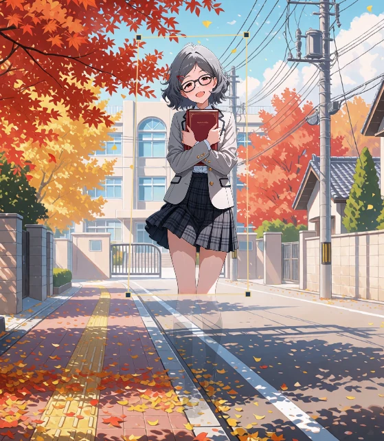

The faint outside pixels are an editing guide. Use Accept to keep Crop, reopen it
to adjust the rectangle, or choose **Reset crop** to reveal the retained source
again. An attached paint child follows its parent's crop.

The dashed outline shows the full image/paint extent; the colored corner handles
edit the shared crop rectangle. Selecting the child does not crop that child
independently. Detach the paint overlay if it needs its own geometry.

For a character, this can hide unwanted margins or lower legs without deleting
their source pixels. Crop changes neither the frame nor other layers. To change
output dimensions, Apply/close Canvas and use the loader's **Resize current**.

## Mask

### Image mode and Mask mode

Press **Mask (M)** in the header to edit the document's independent selection.
The Layers panel becomes **Independent mask**. Brush, Eraser and Fill remain
available; Transform and Eyedropper hide.

The selection is separate from RGB paint, image transparency and attached paint
children. Brush adds coverage, Eraser removes coverage, and Fill edits connected
areas according to its reference setting.

### Coverage and preview settings

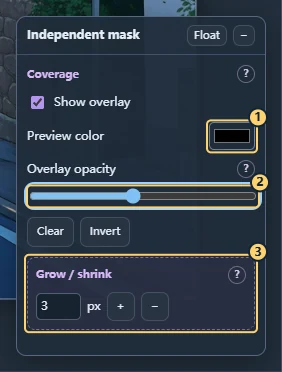

1. **Preview color:** the tint used to display selected coverage.
2. **Overlay opacity:** how strongly that tint appears. The default is black
   at 45%.
3. **Grow / shrink:** expand or contract the authored coverage.

Brush opacity changes the mask coverage you paint. Preview color and Overlay
opacity change its appearance only. **Show overlay** hides the tint without
clearing the mask; switching back to Image mode also lets you inspect the RGB.

### Clear, Invert and Grow / shrink

**Clear** removes all selected coverage. **Invert** exchanges selected and
unselected coverage.

For Grow / shrink, set a radius from **1 to 16 pixels per step** and use **+ / −**,
or scroll inside that control's box. Scroll up to grow and down to shrink. A wheel
burst is one Undo operation. The wheel over the canvas itself zooms instead.

### Using the mask output

After Apply, the loader supplies the selection through **mask**: 1/white is
selected, 0/black is outside. MASK follows the loader's IMAGE alignment choice.

The mask does not erase RGB or automatically create an inpainting latent. For
regional prompting, connect it to a Region set to **External MASK**, with matching
working dimensions; see [regional mask wiring](regions.md#external-mask).

The Region node's own **Edit mask** still opens its separate stock Mask Editor.
That command is not the loader's LuCiD Canvas editing path.

## Preferences and input

### Editor preferences

Open the **gear** in the header to configure mouse behavior and shortcuts.
The first-use offer is optional; choose Use defaults or Configure and revisit
the gear whenever needed.

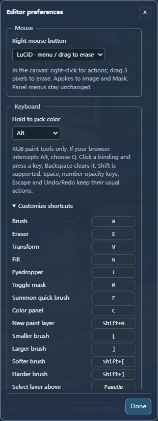

### Right mouse button

| Style | Behavior inside the canvas, in Image and Mask modes |
| --- | --- |
| LuCiD, the default | Stationary right-click opens actions; dragging at least 3 CSS pixels begins erasing |
| Classic | Right button erases without a viewport menu |
| Menu only | Right-click opens actions; right-button erasing is disabled |

These choices do not alter layer-panel menus. **Shift+F10** or the context-menu
key provides keyboard access to actions, including in Classic mode.

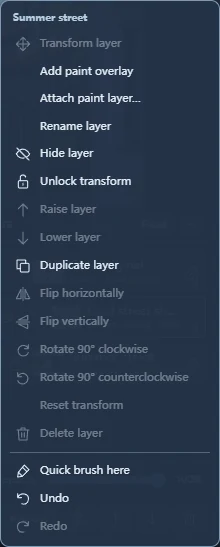

A viewport menu targets the visible hit without switching your active paint row.
Explicit Transform selects its target, and creation commands select the new layer.
For ordinary active-layer changes, use the selection controls in [Layers](#layers).

### Keyboard shortcuts

The [quick-reference table](canvas-reference.md#keyboard-and-pointer-reference)
lists built-in defaults. The header's **?** shows the resolved bindings for your
current settings. Shortcuts need focus inside the editor; text inputs keep their
normal typing keys.

Expand **Customize shortcuts**, click a binding and press a letter, bracket or
navigation key, optionally with Shift. Backspace clears it. Conflicts are
rejected; clear the other binding first. Undo/Redo, Escape, Space and number
opacity keys keep their standard roles.

**Hold to pick color** offers Alt, Q or Off. Choose Q if the browser/OS intercepts
Alt. **Reset behavior / shortcuts** returns to the applicable defaults.

### Automatically remembered settings

These values save silently through their normal controls:

- Last-used brush size, opacity and hardness.
- Up to ten recent colors.
- Mask-preview tint and opacity.
- Quick-brush position.
- Separate docking, collapse state and floating positions for Layers and Mask.
- Transform's Snap to frame toggle.

They are per-user preferences, not document edits. They survive Cancel and do
not enter image Undo. No setup step is required. Reset utilities can restore
panels or remembered state without changing image pixels. Missing/invalid
preference fields have safe fallbacks; a storage failure leaves editing usable.

See [configuration](configuration.md#image-editor-behavior) for the managed
preference file and optional installation defaults.

## Apply, history and saved files

### Apply and Cancel

**Apply** commits the draft as one loader edit turn. It updates the composite
and mask, and retains editable layer assets, image/child relationships and geometry
for reopening. Editing and preview updates do not require running the workflow.

**Cancel** discards the current draft's image changes. It does not undo changes
to remembered brush values, layouts or input preferences.

### Editor Undo versus loader Undo

| History | What one step means | What survives reopening |
| --- | --- | --- |
| Canvas Undo / Redo | An individual stroke or other edit in the current open session | Applied pixels, layers and geometry survive; the individual editing timeline does not |
| Loader Undo / Redo | A completed document turn, such as Apply, import or Resize | Saved document snapshots, with 50 shared across Undo/Redo by default. |

Use Ctrl/Cmd+Z inside Canvas for editor Undo; Ctrl/Cmd+Shift+Z for Redo
(Ctrl+Y also works). Making a new edit after Undo clears that history's Redo
branch. Reopening an applied document starts a fresh editor timeline.

### Workflow files and saving an image

Save the ComfyUI workflow as well as applying the editor. Workflow JSON stores
state and references to image/layer files; it does not bundle those files.
Preserve the resources when moving the workflow or cleaning temporary storage.

To save the composite as an image file in this version, connect the loader's
**image** output to ComfyUI **Save Image** and run that branch. 

For missing assets, budget errors or shortcut problems, see
[troubleshooting](troubleshooting.md). The [limitations page](limitations.md)
describes current scope and compatibility.

## Example files and further reading

The examples in this manual are independent illustrations. You do not need to
complete one before using a different module.

| File | Example use |
| --- | --- |
| [Hills and lake](images/canvas/artwork/hills-and-lake.png) | Layer visibility and Fill |
| [Transparent pines](images/canvas/artwork/foreground-pines.png) | Separate foreground object |
| [Autumn street](images/canvas/artwork/autumn-street.png) | Framing and warm paint |
| [Summer street](images/canvas/artwork/summer-street.png) | Cool shadow paint |
| [Girl holding a book](images/canvas/artwork/girl-with-book.png) | Image transforms and attached paint |

Import a background on the loader, then import foreground objects inside Canvas.
The streets are 2048 × 1024 and the character is 1280 × 1536.

- [Quick editor reference](canvas-reference.md): compact control and shortcut tables.
- [Image loaders](image-loaders.md): dimensions, alignment, latent modes and outputs.
