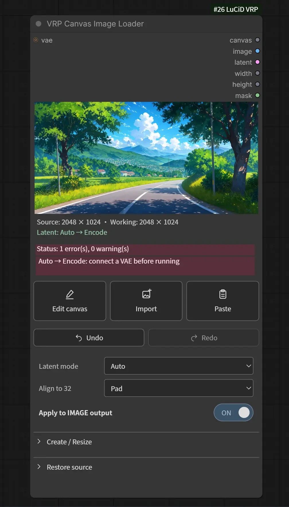
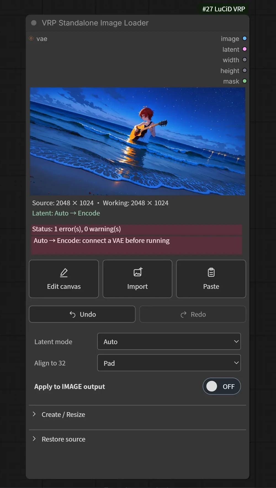
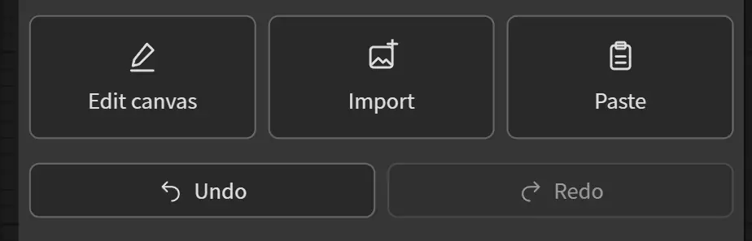
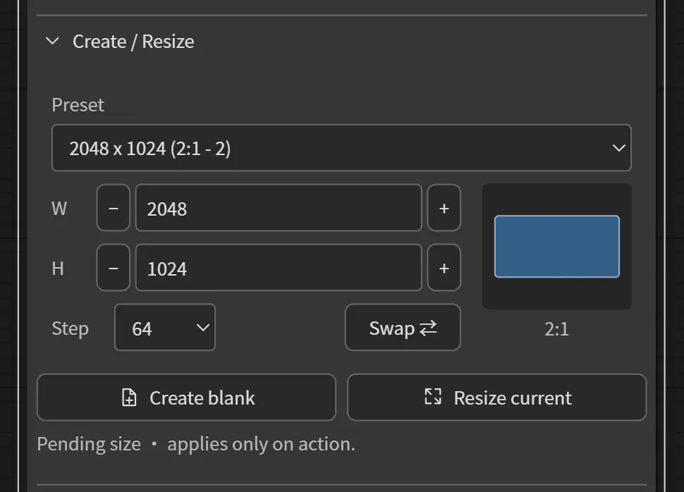
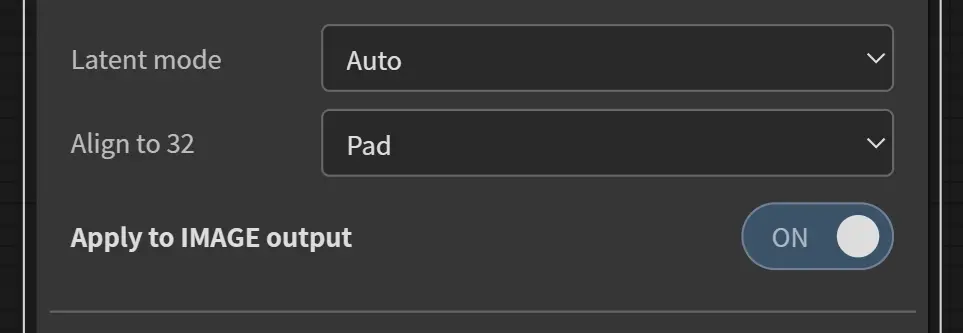
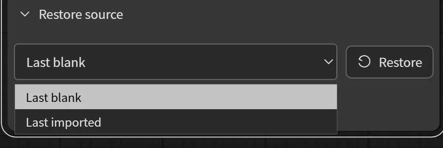

# Working with images

[Introduction](../README.md) · [Canvas manual](canvas-tutorial.md) · [Editor reference](canvas-reference.md) · [Node reference](nodes.md) · [Regions](regions.md)

Use **VRP Canvas Image Loader** when your image defines the canvas for regional
prompting. Use **VRP Standalone Image Loader** when you want the same editing
tools in another image workflow. Standalone has no regional canvas output or
live regional synchronization.

Both keep an active image document, its saved editor layers, and a short
Undo/Redo history. Editing and preview updates happen in the frontend;
encoding the latent happens when the workflow executes.

| Canvas loader | Standalone loader |
| --- | --- |
|  |  |

## Import, paste, and edit

- **Import** opens an image file. You can also drop an image onto the node.
- **Paste** imports the image currently copied to ComfyUI's **Clipspace**.
  For a system-clipboard image, use ComfyUI's normal image-paste interaction;
  the Paste button itself reads Clipspace.
- **Edit canvas** opens the active source in **LuCiD Canvas**, the layered image
  editor. The loader's **Edit Image** right-click entry opens the same editor.
  **Apply** commits the draft as one loader edit turn; **Cancel** discards it.
- Import **inside the editor** to add another image layer. Import on the loader
  replaces its source document instead. The editor supports separate paint layers,
  one attached paint child per image, editable transforms, Distort and layer Crop.

See the [illustrated Canvas manual](canvas-tutorial.md) for the workspace,
layers, paint tools, transforms and masks. The [editor reference](canvas-reference.md)
covers controls, shortcuts, right-button behavior and saved preferences.

RGB paint changes the img2img source. The editor's mask/selection is exported
separately as `mask`, with a pink overlay in the loader preview. Canvas has its
own configurable mask-preview tint, defaulting to black at 45%; neither display
tint changes the output coverage. Transparency in a source imported into the
loader also becomes a mask: transparent/selected pixels are 1, opaque
pixels are 0. An opaque image without a selection returns a zero mask.

The selection does not erase RGB pixels or create a masked latent.
See [regions](regions.md) to use that mask for regional prompting.

## Create or resize

Expand **Create / Resize** to choose a preset or enter Width and Height.

The small blue rectangle previews the **proposed aspect ratio**, not the edited
image. The proposal becomes active only when you press an action:

| Control | Effect |
| --- | --- |
| Preset | Fills the proposed width and height |
| Width / Height | Changes the proposed dimensions |
| Step | Defaults to 32; changes size increments and the size calculated for megapixel presets |
| Swap | Exchanges proposed width/height and selects Custom |
| Create blank | Starts a new white document at the proposed size |
| Resize current | Changes the output frame and scales the composition and mask to that size |

Proposed sizes use the configured grid (default 32), up to 4096. On load or
entry they are rounded up within these bounds, with an info-field notice. Fixed resolution
presets use their configured, grid-normalized dimensions. Megapixel presets keep their aspect ratio
and choose an approximate area aligned to Step. A coarse step can produce more
pixels than the label suggests; reduce Step for finer choices.

**Resize current stretches to the requested dimensions**, including when the
aspect ratio changes. It is separate from the derived alignment-grid adjustment.
For layered Canvas documents, source image/paint rasters and editable crop/warp
records are retained; object placement is scaled and the independent mask is
resized. This differs from **Transform Whole Image** inside Canvas, which changes artwork
inside the existing frame, and from layer **Crop**, which hides part of an object.

## Choose a latent mode

The **Latent mode** control is below the preview and Undo/Redo controls in both
loader screenshots above. It offers these five choices:

| Mode | Use it for |
| --- | --- |
| Auto | Empty for a blank-origin document whose RGB is still white; Encode for imported images or RGB-painted blanks |
| Empty | A native ComfyUI empty-image placeholder at the working canvas size; a compatible sampler resolves its model-specific format |
| Encode | VAE encoding of the current working image for img2img |
| Encode (Tiled) | ComfyUI's tiled VAE encoding of the working image |
| Off | An image/mask-only branch, or a setup supplying its own latent elsewhere |

Auto's effective choice appears beneath the preview. Opening the editor or
painting only a selection on a white blank does not change its RGB, so Auto
can still resolve to Empty. An imported white image resolves to Encode because
it is an imported document.

Connect a compatible VAE for Encode, Encode (Tiled), or Auto when it resolves
to Encode. Tiled uses tile size 512 and overlap 64. It may help with encoding
memory pressure; it does not reduce the sampler's regional-attention memory.
Encode and Encode (Tiled) are visible but disabled without a VAE connection.
Connecting it enables them immediately. A saved choice survives disconnection,
with a missing-VAE message; Auto never silently replaces image content with Empty.
Encoded tensors retain the native VAE's channels and dimensional layout.

Empty is a zero latent, not a VAE encoding of white pixels. Off blocks the
latent branch, so disconnect `latent` if that output is not needed.

## Alignment grid

The default **Align to 32** control creates a derived working view whose dimensions
are multiples of 32. This accommodates common 8x, 16x and 32x image formats.
The configuration setting `minimalstepgranularity` can opt into 16 or 8; these
smaller grids do not satisfy every model's size requirements.

The current **Align to 32** row is visible below Latent mode. The label follows
the configured grid; an 8- or 16-pixel override changes that label too.

| Method | Working size | Pixel adjustment |
| --- | --- | --- |
| Crop | Round each dimension down to the configured multiple | Center crop |
| Pad | Round each dimension up to the configured multiple | Centered edge padding |
| Stretch | Round each dimension up to the configured multiple | Resize to fit |

With the default grid, a 1001 × 753 source becomes 992 × 736 with Crop, or
1024 × 768 with Pad/Stretch. Already aligned images need no adjustment.
Axes smaller than the configured multiple are padded up to it, including in Crop.

Empty always uses rounded-up dimensions (Pad); its alignment selector is
disabled. Alignment creates a working view without rewriting the retained
source or its saved editor layers. **Edit canvas** still opens that source.

The info field explains working-size and loaded-control adjustments. Source
images are never overwritten or relabeled as a different size. Missing VAE and
file errors remain visible alongside compatibility notices. See
[configuration](configuration.md#loader-alignment-and-minimum-step).

### Apply to IMAGE output

This switch chooses which pixels leave the `image` output:

| Setting | IMAGE, width, height, MASK | Regional canvas and encoded latent |
| --- | --- | --- |
| ON | Aligned working size | Aligned working size |
| OFF | Source size | Aligned working size |

It defaults to **ON in Canvas** and **OFF in Standalone**. If it is OFF, do not
assume the IMAGE dimensions describe the latent or regional canvas.
The mask follows the IMAGE choice; padding outside a selection is zero.

For example, with a 1001 × 753 source and Pad, OFF returns a 1001 × 753 image
and mask while Encode processes 1024 × 768 pixels. ON returns the aligned
1024 × 768 image and mask too.

## Undo, redo, and retained sources

**Undo** returns to the preceding saved document state; **Redo** moves forward
again. Imports, saved edits, Create blank, and Resize current can make history
entries. Changing a proposed size or swapping it does not.

By default, **50 snapshots** are shared between Undo and Redo. Configure
`loader_history_limit` (1–1000) in [configuration](configuration.md#loader-undoredo-history).
Making a new change
after Undo clears the Redo branch. Saved layers, image/paint relationships,
transforms and crops are restored with their document. Inside Canvas, Undo/Redo
steps through individual edits in the current session; those individual history
steps are not restored after closing and reopening the editor.

Expand **Restore source** to select **Last blank** or **Last imported**, then
press **Restore**.

These retain the latest document state for each origin, including edits.
They are separate from the Undo/Redo timeline, not an unlimited archive
or a guarantee of the pristine original file.

## Saving and moving a workflow

The workflow saves document state, history, and file references. Preserve the
files too, including editable layer assets and painted regional masks.
A workflow JSON or embedded workflow alone does not bundle these resources.

This version does not provide direct image-file or PSD export from Canvas.
Connect `image` to ComfyUI **Save Image** and run that branch to save the composite.

VRP does not automatically clean unused files. See
[images and editor files](limitations.md#images-and-editor-files) before
cleaning ComfyUI's temporary storage.
