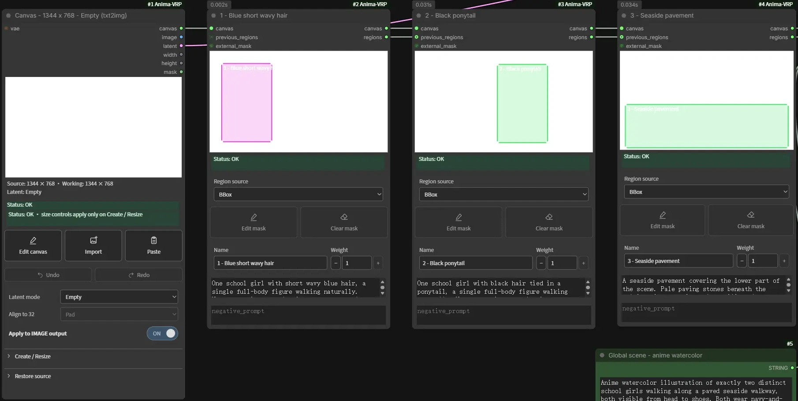
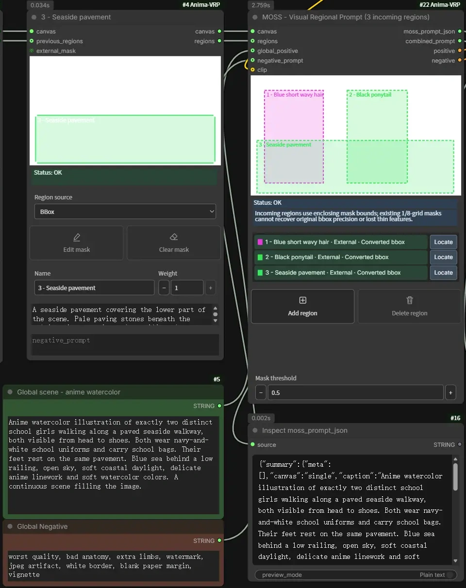

# MOSS-Image layout prompting

[Node reference](nodes.md) · [Regions](regions.md) · [Image loaders](image-loaders.md) · [Troubleshooting](troubleshooting.md#moss-boxes-or-text-do-not-match-the-intended-layout)

**MOSS - Visual Regional Prompt** turns a canvas, boxes and captions into a
MOSS-Image layout prompt. With a compatible text encoder connected, it also
produces positive and negative conditioning for a native MOSS generation graph.
This is MOSS layout prompting; Anima's attention patch, Prompt Mix and regional
negative controls do not apply.

## Load the example

Drag the original [workflow image](images/workflows/moss-sft-layout.webp)
into classic ComfyUI. The workflow is embedded in that WebP. Select your installed
MOSS-Image SFT model, Qwen 3.5 9B text encoder and Flux.2 VAE in their respective
loaders. Set the CLIP loader type to `moss_image`. The embedded graph names an
int8 Qwen encoder; select a compatible installed variant if yours differs. Model
files are not included or downloaded by VRP. MOSS generation requires a ComfyUI
version with native MOSS-Image support.

The screenshot shows the layout portion of the graph and a sample result. The
model loaders, sampler and decoder are elsewhere in the embedded workflow.
The crops below show details from this same capture; use the original WebP above
to load the workflow.

## Build the scene with Regions

The example starts with a blank **1344 × 768** Canvas in **Empty** latent mode.
Three external Region nodes follow it, each using **BBox** as its region source:

1. **Blue short wavy hair** defines the left figure.
2. **Black ponytail** defines the figure to the right.
3. **Seaside pavement** spans the lower part of the scene and overlaps both
   figure boxes.

Each Region owns its box and positive caption. Drag the box to move it, or drag
an edge or corner to resize it. The boxes describe requested placement; they do
not mark exact generated-object boundaries. The shared pavement can overlap the
figures because it describes part of the same scene.

The nodes are connected as a chain:

| From | To |
| --- | --- |
| Canvas `canvas` | First Region `canvas` |
| Each Region `canvas` | Next Region `canvas` |
| Each Region `regions` | Next Region `previous_regions` |
| Final Region `canvas` | MOSS `canvas` |
| Final Region `regions` | MOSS `regions` |

Both final connections matter: the canvas carries canvas information, while
`regions` carries the region list. The Canvas `latent` also goes to KSampler's
`latent_image` input for this text-to-image example.

## Write the prompts

The **Global scene - anime watercolor** text node connects to MOSS
`global_positive`. It describes the two figures together, their uniforms, the
sea, light and visual style. Each Region caption describes its own subject or
setting. Keep the global scene compatible with the boxes; in this example, the
individual hair descriptions live in the Region captions so the boxes can
establish their positions.

**Global Negative** connects to `negative_prompt`. A connected input takes
precedence over the MOSS node's local `global_negative` field, even when the
connected text is empty. Regional negative prompts are not included in the MOSS
layout or global negative.

The dashed boxes and the three entries on the MOSS node represent the incoming
Regions. Use **Locate** to select and frame the owning Region, then edit its box
or caption there. Weight 0 excludes an external Region; a positive fractional
weight includes it but has no corresponding fractional-strength field in the
MOSS layout. The node reports that limitation.

## Inspect and generate

The MOSS node has four outputs:

| Output | Purpose |
| --- | --- |
| `moss_prompt_json` | The MOSS layout JSON, shown in **Inspect moss_prompt_json** |
| `combined_prompt` | Scene and enabled, nonempty region captions joined as plain text |
| `positive` | Layout JSON encoded through the connected CLIP |
| `negative` | Global negative encoded separately through the connected CLIP |

The example connects `combined_prompt` to **Preview Combined Prompts** and both
conditioning outputs to KSampler. Its model passes through **Skip Layer Guidance
DiT Simple** with single layer `22`, start `0` and end `1`. The sampler uses
50 steps, CFG 3, Euler, `sgm_uniform` and denoise 1; VAE Decode uses the Flux.2
VAE before Save Image. These values are starting settings, not a universal
quality preset. The displayed result is one example, not a guarantee that every
seed will follow every box or preserve each identity.

To inspect text without loading a model, disconnect the MOSS `clip` input, leave
Canvas latent mode **Off** or **Empty**, and queue a branch ending in a text
preview. The text outputs still work, but conditioning consumers are skipped
without CLIP. Drawing and known-state editor updates do not require queueing.
If another model needs the scene text, use `combined_prompt` with that model's
own text encoder; MOSS conditioning is not interchangeable with it.

## Add internal boxes or use masks

The example uses external Regions and starts with no internal MOSS boxes. For a
compact setup, connect a Canvas directly to MOSS, draw on empty preview space or
press **Add region**, then select the box and edit its name and positive
caption. **Include region** temporarily disables an internal box; **Delete
region** removes an internal box. These controls do not modify incoming Region
nodes. Internal and external regions can coexist: internal boxes export in list
order, followed by enabled external Regions in chain order.

Painted or external Region masks are converted to one enclosing rectangle per
Region above **Mask threshold** (0.5 in the example). The rectangle also encloses
gaps between separate mask islands. Incoming masks use the existing 1/8 canvas
grid, so converted boxes retain that precision limit. Internal boxes avoid that
mask-grid round trip.

Canvas dimensions must match generation dimensions and be divisible by 16.
VRP converts normalized boxes to enclosing integer pixel edges in MOSS's
center-origin `[y0, x0, y1, x1]` format. Editor names are not exported as MOSS
object types: items currently use `label: "object"`. Empty region captions are
omitted and reported; an empty global scene is allowed when usable regional
captions are present, and a scene alone is also usable. Check the MOSS node's
status for conversion warnings.

Save the edited workflow to preserve boxes and prompts. If you use imported
images or painted masks, preserve their referenced files separately; see
[file persistence](limitations.md#images-and-editor-files). For missing
regions, negative-input precedence or disabled conditioning, see
[MOSS troubleshooting](troubleshooting.md#moss-boxes-or-text-do-not-match-the-intended-layout).
