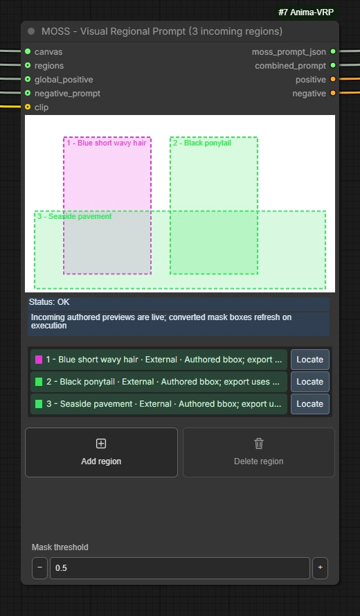
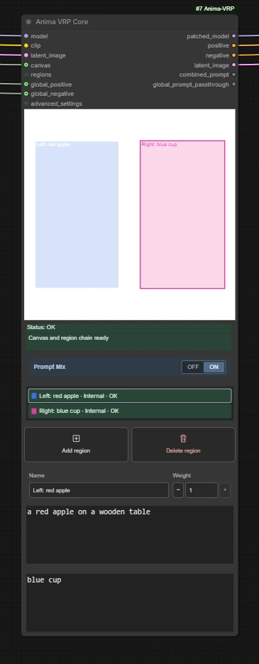
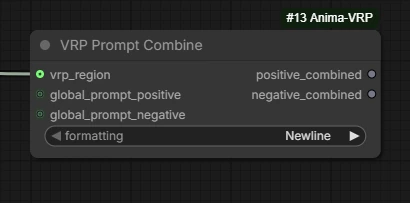

# Node reference

[Introduction](../README.md) · [Image loaders](image-loaders.md) · [Regions and prompts](regions.md)

Find the nodes under **LuCiD VRP** in ComfyUI's Add Node menu. In this guide,
**Core** refers to **Anima VRP - Visual Regional Prompt**. MOSS has its own
visual prompting node.

| Node | Use it for |
| --- | --- |
| VRP Canvas Image Loader | Create or edit an image and share its canvas with regional nodes |
| VRP Standalone Image Loader | Use the same image tools in other workflows without a regional canvas |
| Anima VRP - Visual Regional Prompt | Define internal boxes, encode prompts, and apply Anima regional conditioning |
| MOSS - Visual Regional Prompt | Exporting bbox layout JSON and optional native MOSS conditioning |
| VRP Region | One box, painted mask, or external mask, with its own prompts |
| VRP Prompt Combine | Collecting external Region prompts for another text-encoding branch |
| Anima VRP Adv. Settings (Easy UI) | Adjusting regional conditioning with grouped controls |
| Anima VRP Adv. Settings (Simple UI) | The same settings through standard widgets |

## Image loaders

Both loaders offer Import, Paste, Edit canvas, Undo/Redo, Create / Resize,
Restore source, and optional VAE encoding. See the [image-loader guide](image-loaders.md)
for their controls and alignment behavior. **Edit canvas** opens LuCiD Canvas;
see the [illustrated manual](canvas-tutorial.md) and
[editor reference](canvas-reference.md) for its layers, transforms and masks.

Connect a `vae` (VAE) when using Encode, Encode (Tiled), or Auto when it
resolves to Encode. The input is optional for Empty and Off.

| Output | Type | Meaning |
| --- | --- | --- |
| `canvas` | VRP_CANVAS | Regional canvas metadata; **Canvas loader only** |
| `image` | IMAGE | The edited source, optionally aligned to the configured grid (default 32) |
| `latent` | LATENT | Native empty placeholder or VAE-encoded latent; unavailable in Off mode |
| `width`, `height` | INT | Dimensions of the `image` output |
| `mask` | MASK | Independent editor selection or imported source transparency; follows `image` dimensions |

Canvas output order is `canvas`, `image`, `latent`, `width`, `height`, `mask`.
Standalone has the same order without `canvas`.

**Apply to IMAGE output** defaults to ON in the Canvas loader and OFF in the
Standalone loader. For an imported image that needs alignment, the regional
`canvas` and encoded latent use the aligned working size. The `image`, `width`,
`height`, and `mask` outputs follow the switch. See
[alignment](image-loaders.md#apply-to-image-output) for examples.

## MOSS - Visual Regional Prompt

Connect `canvas` (VRP_CANVAS), then draw boxes in the node or connect a Region
chain to `regions` (VRP_REGIONS). Edit incoming regions in their own Region
nodes. Use `global_positive` for the overall scene.

Painted and external masks export as one enclosing rectangle above
`mask_threshold`, including gaps between mask islands. Incoming Region masks
have 1/8-grid precision. Canvas dimensions must be divisible by 16 and match
the generation dimensions.

Connect a compatible `clip` to encode the layout JSON as positive conditioning
and the global negative text as negative conditioning. A connected
`negative_prompt` STRING overrides the local `global_negative` field, even if
the connected text is empty. Regional negative text and fractional weights are
not MOSS conditioning controls; zero weight excludes a region. The node does
not patch a model.

Outputs, in order: `moss_prompt_json` (STRING), `combined_prompt` (STRING),
`positive` (CONDITIONING), `negative` (CONDITIONING). Combined text joins the
scene and enabled exported captions for use with a refiner's own encoder.
Without CLIP, the text outputs remain available and conditioning consumers are
skipped. Check the node's status for conversion warnings.

See the [MOSS example and setup](moss-layout.md#load-the-example)
for the required native MOSS nodes and model selections.

The [MOSS layout guide](moss-layout.md) explains internal versus incoming
boxes, prompt inputs, model-free JSON export and mask conversion limits.

## Anima VRP - Visual Regional Prompt

Use Core between your Anima loaders and a normal KSampler. Draw internal boxes
here, add external Region nodes, or combine both.

| Input | Type | Required? | Connect |
| --- | --- | --- | --- |
| `model` | MODEL | Yes | Your Anima model, including intended upstream patches |
| `clip` | CLIP | Yes | Anima's text encoders |
| `latent_image` | LATENT | Yes | An empty or encoded Anima image latent |
| `canvas` | VRP_CANVAS | With external regions | Canvas loader, or the final Region's relay output |
| `regions` | VRP_REGIONS | No | Final Region's accumulated region output |
| `global_positive` | STRING | No | Text describing the whole image |
| `global_negative` | STRING | No | Negative text for the whole image |
| `advanced_settings` | VRP_ADVSETTINGS | No | Either Advanced Settings node |

Connecting a Canvas loader is the simplest way to keep the editor and latent
dimensions together, even with only internal boxes. Without one, the saved
internal canvas dimensions must still match the supplied latent.

| Output | Type | Connect / meaning |
| --- | --- | --- |
| `patched_model` | MODEL | KSampler's `model` |
| `positive` | CONDITIONING | KSampler's `positive` |
| `negative` | CONDITIONING | KSampler's `negative` |
| `latent_image` | LATENT | KSampler's `latent_image`; passed through unchanged |
| `combined_prompt` | STRING | Global positive plus active internal and external regional positives, regardless of Prompt Mix |
| `global_prompt_passthrough` | STRING | The positive text actually encoded: combined when Prompt Mix is ON, global only when OFF |

**Prompt Mix is ON by default.** It adds regional positive text to the global
positive encoding while keeping regional routing. Regional negatives stay
regional. See [Prompt Mix](regions.md#prompt-mix) for an example.

Internal box geometry, prompts, names, and weights are stored in the workflow.
The underlying `vrp_state` widget is serialized editor data; use the visual
controls rather than editing its JSON.

## VRP Region

Each node contributes one region. Use **Region source** to choose BBox,
Painted Mask, or External MASK. Its Name, Weight, positive prompt, and negative
prompt belong to that region.

| Input | Type | Use |
| --- | --- | --- |
| `canvas` | VRP_CANVAS | Required; the canvas this region belongs to |
| `previous_regions` | VRP_REGIONS | Optional; accumulated output from the previous Region |
| `external_mask` | MASK | Required in External MASK mode; ignored by the other two modes |

| Output | Type | Use |
| --- | --- | --- |
| `canvas` | VRP_CANVAS | Relay to the next Region or Core |
| `regions` | VRP_REGIONS | This region plus all regions from `previous_regions` |

**Connect both outputs along the chain and into Core.** The `canvas` relay does
not contain the region list. See [external-region wiring](regions.md#connect-external-regions).

Weight ranges from 0 to 1; 0 makes a region inactive. New nodes start in BBox
mode at weight 1. The workflow saves each region's geometry and identity.

## VRP Prompt Combine

Use this when another branch needs the external Region chain's text, for
example a refiner that should run independently of Core. It returns strings;
connect them to your refiner's text encoders.

| Input | Type | Use |
| --- | --- | --- |
| `vrp_region` | VRP_REGIONS | Optional; connect the final Region directly |
| `global_prompt_positive` | STRING | Optional global positive |
| `global_prompt_negative` | STRING | Optional global negative |

Outputs are `positive_combined` and `negative_combined`, both STRING. Each
starts with its global text, then active regional text in chain order.
Empty entries and weight-zero regions are omitted. Fractional weights do not
multiply the text, and repeated text is kept.

Choose **Newline** to keep prompt contents and join entries with newlines.
**Commas** converts newline/comma separators into a normalized comma-separated
string and collapses whitespace; escaped literal commas and weighting
punctuation are retained. Use Newline when prompt syntax depends on whitespace.

This utility cannot read Core's internal boxes. Unlike Core's Prompt Mix,
it deliberately joins regional negatives into its separate negative string.
Without a region input, it formats the supplied global strings only.

Prompt Combine does not encode text or patch a model. Its connected producers
still run when needed: bypassing Core alone does not bypass a connected loader's
VAE encoding or a Region's processing.

## Advanced Settings nodes

Both presentations output `settings` (VRP_ADVSETTINGS) for Core's
`advanced_settings` input and produce the same values. Leave this input
disconnected to use **VRP Recommended** defaults.

The [advanced-settings guide](advanced-settings.md) explains the presets,
individual controls, and performance tradeoffs.

## User configuration

For custom presets, status colors, layout, and default boxes, see
[Configuration](configuration.md). These are optional startup settings;
they do not replace document or region state in existing workflows.

## Workflow IDs and older nodes

These IDs can help identify nodes in workflow JSON or when reporting a missing
node. The LuCiD naming change preserves the IDs and saved node state.

| Display name | ID |
| --- | --- |
| VRP Canvas Image Loader | `VRPCanvasUI` |
| VRP Standalone Image Loader | `VRPStandaloneImageLoader` |
| Anima VRP - Visual Regional Prompt | `AnimaVRPUI` |
| VRP Region | `VRPRegionUI` |
| VRP Prompt Combine | `VRPPromptCombine` |
| MOSS - Visual Regional Prompt | `MOSSVisualRegionalPromptExperimental` |
| Anima VRP Adv. Settings (Easy UI) | `VRPAdvancedSettingsUI` |
| Anima VRP Adv. Settings (Simple UI) | `VRPAdvancedSettings` |

Optional [debug configuration](configuration.md#legacy-nodes) also registers
VRP Canvas Image Loader (Legacy), VRP Region (Legacy), and Anima VRP (Legacy).
They use the same backends with an older presentation.

When opening an older experimental MOSS workflow, check its restored connections
before running it. The former report output has been removed; conversion
warnings appear in the node's status.
