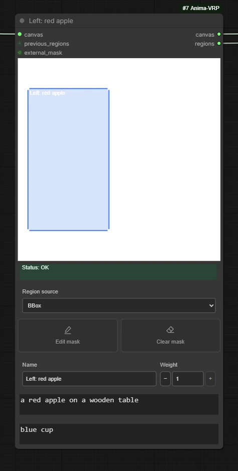

# Regions and prompts

[Introduction](../README.md) · [Node reference](nodes.md)

Use global prompts for the shared scene and regional prompts for details you
want associated with a particular area. For example, describe a street and its
lighting globally, then give the person on each side a separate regional prompt.

Regions guide attention; their outlines are not guaranteed object boundaries.
Subjects can still move, overlap, or pick up details from the broader scene.

This page describes **Anima regional conditioning**. The [MOSS layout node](moss-layout.md)
reuses the authoring tools but exports rectangular layout instructions; it does
not provide Anima's regional negatives or fractional routing strength.

## Choose how to author regions

| Approach | Choose it when |
| --- | --- |
| Internal boxes in Core | You want a compact setup with a few rectangular areas |
| External Region: BBox | You want separate nodes and prompts for each rectangle |
| External Region: Painted Mask | You want to draw a region with the native Mask Editor |
| External Region: External MASK | You already have a mask from another node |

Internal and external regions can be used together. External regions add to the
internal ones; they do not replace them.

## Draw boxes in Core

1. Connect the Canvas loader's `canvas` to Core's `canvas`. Feed Core a latent
   from that same canvas size.
2. Press **Add region** to create a box, or drag on empty space in the preview
   to draw one.
3. Select the box in the preview or region list. Drag inside it to move it, or
   drag an edge/corner to resize it.
4. Set its **Name**, **Weight**, positive prompt, and negative prompt.
5. Repeat for the remaining regions. **Delete region** removes the selected
   internal region.

The selected region's prompt fields change as you select another region.
Boxes are stored as proportions of the canvas, so they keep their relative
placement when the canvas size changes. Check the composition after a resize.

Core's list also shows connected external regions. Edit those in their owning
Region nodes; the list's locate action helps you find them in the graph.

## Connect external regions

Carry two connections forward: **canvas** and **regions**.

| From | To |
| --- | --- |
| Canvas loader `canvas` | Region A `canvas` |
| Region A `canvas` | Region B `canvas` |
| Region A `regions` | Region B `previous_regions` |
| Region B `canvas` | Core `canvas` |
| Region B `regions` | Core `regions` |
| Canvas loader `latent` | Core `latent_image` |

For a longer chain, repeat the middle two connections for each additional
Region. The final `regions` output contains the accumulated chain.

Each Region needs a Name, prompts, a Weight, and geometry for its selected
source. Names help identify entries in previews and errors. New frontend nodes
receive their own IDs; if you build workflows through an API, keep IDs unique
across internal and external regions.



### BBox

Choose **BBox** under Region source. Drag on the Region's preview to draw a
rectangle, then move or resize it by dragging its interior or edges. Drawing
another box replaces that node's box. Use another Region node for another box.

### Painted Mask

1. Choose **Painted Mask** and connect a ready canvas.
2. Press **Edit mask**.
3. Paint the desired selection in ComfyUI's Mask Editor and save it.
4. Check the overlay in the Region and Core previews.

Use the editor's mask/selection tools to define the region. RGB painting is
not the regional mask. **Clear mask** clears the saved selection; repaint it
or deactivate the region before sampling, since an active empty mask cannot
provide regional conditioning.

The Region mask editor controls where that region applies. It remains the stock
Mask Editor. To change the actual img2img source, use **Edit canvas** on the image
loader, which opens the separate [LuCiD Canvas editor](canvas-tutorial.md).
Canvas's independent mask can also feed a Region through **External MASK**;
painting RGB onto an image child is not the same as painting that mask.

### External MASK

Choose **External MASK**, then connect a MASK to `external_mask`.
Values near 1 select the region; 0 is outside it. Input values are clamped to
0–1. The regional token conversion uses spatial membership, so do not assume
that a soft mask produces a proportional alpha blend in the generated image.

The mask must contain a single image and match either:

- The working canvas size, such as 1024 × 1024.
- Its Anima latent spatial size, such as 128 × 128 for that canvas.

Other sizes are rejected rather than silently fitted. If using a loader's
`mask` output, enable **Apply to IMAGE output** so it matches the aligned canvas.
The Standalone loader can supply a mask, but a Region still needs `canvas`
from a Canvas loader.

## Live previews and execution

Internal boxes, external boxes, saved painted masks, and canvas edits are known
to the frontend and update their previews without running the workflow.

A mask produced by another workflow node may require execution before VRP can
display its evaluated result. After changing that producer, a previous result
can be marked stale until the workflow runs again. A preview is a layout aid;
it does not predict the generated image.

## Positive and negative prompts

Write shared style, environment, and composition in `global_positive`.
Use each region's positive prompt for local subjects and attributes. Keep
global text compatible with the local prompts when you want clear separation.

`global_negative` applies across the image. A region's negative prompt follows
that region's spatial routing. Empty negative prompts are allowed.

<a id="why-regional-negatives-are-not-joined"></a>

Core never appends regional negatives to the global negative. Doing so would
apply those instructions across the entire image. [Prompt Combine](nodes.md#vrp-prompt-combine)
provides a separate, explicit negative-text join if a refiner branch needs one.

### Prompt Mix

**Prompt Mix defaults to ON.** It includes active regional positives in Core's
global positive encoding as well as keeping their regional conditioning.

For these prompts:

```text
Global: a sunlit street, two people
Region A: a person wearing a red coat
Region B: a person wearing a blue coat
```

With Prompt Mix ON, the text encoded into Core's `positive` output is:

```text
a sunlit street, two people
a person wearing a red coat
a person wearing a blue coat
```

With it OFF, that output encodes only `a sunlit street, two people`. Both
regional prompts still participate in regional routing. Try OFF if you want
to compare against a global prompt without the regional text mixed in.

Ordering is global, active internal regions in list order, then active external
regions in chain order. Empty entries are omitted; repeated text and prompt
syntax are preserved.

### Weight, overlap, and inactive regions

Weight ranges from 0 to 1. **0 disables the region**, including its contribution
to mixed/combined text. Fractional values affect regional routing strength;
they are not a percentage of the final image or a text-weight multiplier.

Overlapping regions can both influence the shared area. There is no
last-region-wins paint order. Very small boxes or thin masks may disappear
when converted to Anima's token grid; enlarge them if Core reports that a
region is too small.

To temporarily remove one external region while keeping earlier regions in
the chain, set its Weight to 0. ComfyUI's Mute stops that producer's branch;
it does not pass the accumulated inputs through. Bypass can relay a chain,
but check the resulting connections and previews after changing node modes.

## Send prompts to a refiner

For internal and external regions together, Core's `combined_prompt` gives
the joined positive string whether Prompt Mix is ON or OFF.
`global_prompt_passthrough` gives the positive string Core actually encoded.
Both require Core's execution when their outputs are requested.

For an independent external-region branch, connect the final Region's
`regions` directly to **VRP Prompt Combine**. Feed its positive and negative
strings to separate text encoders. This utility does not read internal boxes
or recover text from disconnected or disabled Region producers.

## Save and reopen

Save your workflow to preserve box geometry, names, prompts, weights, and
references to painted masks. Image and editor-layer files remain separate
files in ComfyUI; workflow JSON alone does not package them.

When moving a workflow to another installation, bring its referenced images
and masks too. See [file persistence](limitations.md#images-and-editor-files)
and [restoration troubleshooting](troubleshooting.md#missing-images-or-editor-layers).
